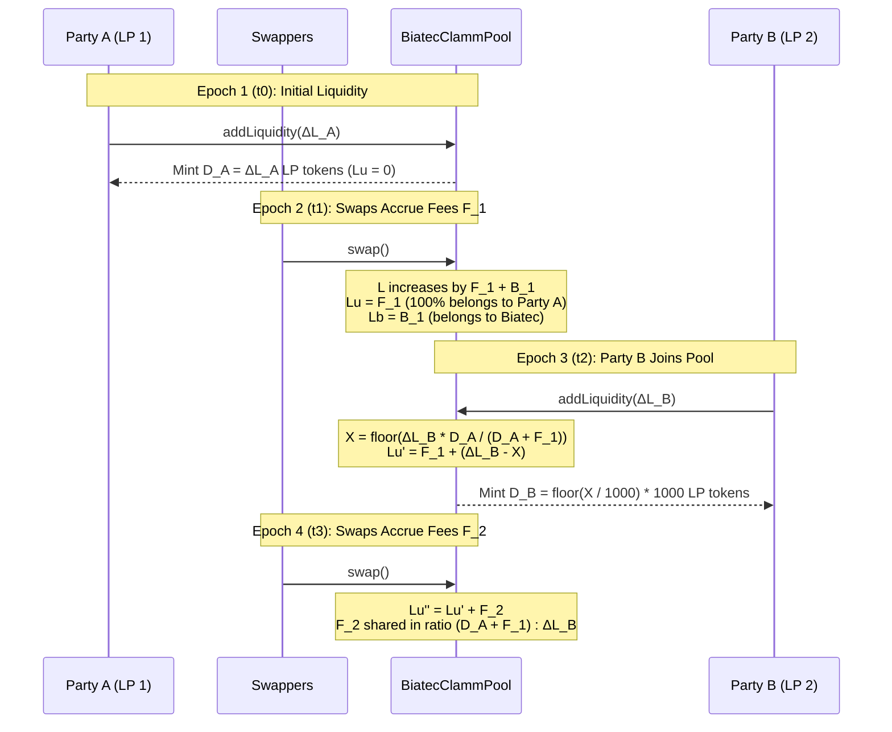

# Multi-Party Liquidity Aggregation & Fee Fairness Proof

This document provides the complete mathematical proof, accounting model, numerical walkthroughs, and on-chain test verification demonstrating that **Biatec CLAMM** (`BIATEC-CLAMM-01-06-08`) collects and distributes fees accurately when multiple users provide and withdraw liquidity in the same pool at different times.

Specifically, this guide proves that:

1. **No Fee Loss**: 100% of swap fees and distributed staking rewards are captured on-chain and partitioned between liquidity providers (`LiquidityUsersFromFees`) and the protocol (`LiquidityBiatecFromFees`) with zero unallocated leakage.
2. **No Fee Scooping by Late Joiners**: A liquidity provider who joins a pool *after* fees have accrued cannot extract any portion of the fees earned prior to their deposit.
3. **No Dilution of Incumbent LPs**: Existing liquidity providers retain 100% of their principal and 100% of their previously accrued fees when new liquidity providers join the pool, and their accrued fees automatically compound as active liquidity for subsequent trades.
4. **Order-Independent Withdrawals**: When multiple liquidity providers exit a pool, the payout to each participant is independent of who withdraws first (up to $\le 2$ atomic asset units of integer division flooring, which always rounds in favor of the remaining pool).

---

## 1. On-Chain Accounting Variables & Conservation Invariant {#-1-on-chain-accounting-variables--conservation-invariant}

Every `BiatecClammPool` contract maintains four core liquidity quantities in 9-decimal base scale ($\text{SCALE} = 10^9$):

| Symbol | Contract State / Formula | Description |
| :--- | :--- | :--- |
| $L$ | `Liquidity` (`L`) | Total concentrated liquidity derived from tracked reserves $(x, y) = (\text{assetABalanceBaseScale}, \text{assetBBalanceBaseScale})$. |
| $D$ | `distributedLp` | Circulating LP tokens held outside the pool account, scaled to 9 decimals: $D = (\text{TOTAL\_SUPPLY} - \text{poolLpBalance}) \times 1000$. |
| $L_u$ | `LiquidityUsersFromFees` (`Lu`) | Accumulated fee/reward liquidity owned pro rata by circulating LP token holders. |
| $L_b$ | `LiquidityBiatecFromFees` (`Lb`) | Accumulated protocol fee liquidity owned by the Biatec fee executor (`addressExecutiveFee`). |

### Fundamental Conservation Invariant {#-fundamental-conservation-invariant}

At every point in the pool lifecycle, total curve liquidity $L$ satisfies:

$$
L = D + L_u + L_b + U
$$

where:

- $D + L_u$ is the total liquidity claim of all LP token holders (redeemable via `removeLiquidity`),
- $L_b$ is the total liquidity claim of the protocol fee executor (redeemable via `removeLiquidityAdmin`),
- $U$ is the sub-micro-LP integer flooring remainder ($0 \le U < 1000\text{ base units} = 10^{-6}\text{ LP}$ per deposit), which can be credited to $L_u$ (or $L_b$ if $D = 0$) at any time via `reconcileLiquidity`.

---

## 2. How Fees Are Collected on Every Swap and Reward Distribution {#-2-how-fees-are-collected-on-every-swap-and-reward-distribution}

### 2.1 Swap Fee Accrual (`swap`) {#-21-swap-fee-accrual-swap}

When a trader swaps input amount $\Delta_{\text{in}}$ (in base scale):

1. **Fee Deduction Before Curve Pricing**:
   The contract computes the effective fee multiplier from the pool's `fee` parameter and the trader's `BiatecIdentityProvider` tier:

   $$
   \text{feesMultiplier} = s - \left\lfloor \frac{\text{fee} \cdot \text{user.feeMultiplier}}{\text{user.base}} \right\rfloor, \quad s = 10^9
   $$

   Only the net input $\Delta_{\text{in,afterFee}} = \lfloor \Delta_{\text{in}} \cdot \text{feesMultiplier} / s \rfloor$ is used to compute the counter-asset output $\Delta_{\text{out}}$ along the constant-liquidity curve $L_{\text{old}}$.

2. **Output Rounding Protection**:
   When converting $\Delta_{\text{out}}$ from 9-decimal base scale to the output asset's native decimals, any non-zero fractional remainder causes the output to be stepped down by 1 native asset unit (`realSwapBDecimals = realSwapBDecimals - 1`), ensuring integer conversion never bleeds pool reserves.

3. **Reserve Update & Liquidity Recomputation**:
   The full input $\Delta_{\text{in}}$ (including the fee portion $\Delta_{\text{in}} - \Delta_{\text{in,afterFee}}$) is added to the incoming reserve, while only the transferred output $\Delta_{\text{out,real}}$ is subtracted from the outgoing reserve. The contract then recomputes pool liquidity:

   $$
   L_{\text{new}} = \text{setCurrentLiquidityNonDecreasing}(L_{\text{old}}) \ge L_{\text{old}}
   $$

4. **Exhaustive Fee Partition ($\Delta L_u + \Delta L_b = \text{diff}$)**:
   The liquidity gain $\text{diff} = L_{\text{new}} - L_{\text{old}}$ is split between LP holders and Biatec:

   $$
   \Delta L_u = \left\lfloor \frac{\text{diff} \cdot (s - f_{\text{biatec}})}{s} \right\rfloor, \quad \Delta L_b = \text{diff} - \Delta L_u
   $$

   Because $\Delta L_b$ is defined as $\text{diff} - \Delta L_u$, the sum $\Delta L_u + \Delta L_b = \text{diff}$ holds **identically** with zero rounding loss.

### 2.2 Staking & Excess Asset Distribution (`distributeExcessAssets`) {#-22-staking--excess-asset-distribution-distributeexcessassets}

When staking rewards or external yield are credited via `distributeExcessAssets`, the contract verifies physical backing (`ensurePoolBalancesWithinHoldings`), computes $\text{diff} = L_{\text{new}} - L_{\text{old}}$, and applies the identical exhaustive split $\Delta L_u + \Delta L_b = \text{diff}$.

---

## 3. Mathematical Proof: Aggregating Liquidity of Multiple Parties at Different Times {#-3-mathematical-proof-aggregating-liquidity-of-multiple-parties-at-different-times}

Consider two independent liquidity providers — **Party A (Incumbent)** and **Party B (Newcomer)** — who deposit into the same pool at different times $t_0 < t_2$, with swaps occurring both before ($t_1$) and after ($t_3$) Party B joins.



### Step 1 ($t_0$): Party A Supplies Initial Liquidity {#-step-1-t0-party-a-supplies-initial-liquidity}

Party A deposits assets adding $\Delta L_A$ of liquidity into an empty pool ($D_0 = 0, L_{u,0} = 0, L_{b,0} = 0$).

- Party A receives $d_A = \lfloor \Delta L_A / 1000 \rfloor$ micro-LP tokens, corresponding to $D_A = 1000 \, d_A = \Delta L_A - r_A$ base units ($0 \le r_A < 1000$).
- Pool state after $t_0$:

  $$
  D_1 = D_A, \quad L_{u,1} = 0, \quad L_{b,1} = 0, \quad L_1 = D_A + r_A
  $$

### Step 2 ($t_1$): Swaps Accrue Fees $F_1$ While Only Party A Is in the Pool {#-step-2-t1-swaps-accrue-fees-f1-while-only-party-a-is-in-the-pool}

Swaps during $[t_0, t_1]$ generate user fee liquidity $F_1 > 0$ and protocol fee liquidity $B_1 \ge 0$.

- Pool state at $t_1$:

  $$
  D_1 = D_A, \quad L_{u,1} = F_1, \quad L_{b,1} = B_1, \quad L_1' = D_A + F_1 + B_1 + r_A
  $$

- Because Party A holds 100% of circulating LP tokens ($D_1 = D_A$), Party A's redeemable liquidity entitlement at $t_1$ is:

  $$
  \text{Claim}_A(t_1) = D_A + \left\lfloor \frac{L_{u,1} \cdot D_A}{D_A} \right\rfloor = D_A + F_1
  $$

- Each base unit of circulating LP token is now backed by $\frac{D_A + F_1}{D_A} > 1$ units of user liquidity.

### Step 3 ($t_2$): Party B Deposits $\Delta L_B$ Into the Pool {#-step-3-t2-party-b-deposits-deltalb-into-the-pool}

At $t_2$, Party B deposits assets that increase pool liquidity from $L_1'$ to $L_2 = L_1' + \Delta L_B$.

In `processAddLiquidity`, the contract computes the fee-adjusted LP mint amount $X_{\text{base}}$:

$$
X_{\text{base}} = \left\lfloor \frac{\Delta L_B \cdot D_A}{D_A + F_1} \right\rfloor
$$

Party B is minted $d_B = \lfloor X_{\text{base}} / 1000 \rfloor$ micro-LP tokens ($D_B = 1000 \, d_B = X_{\text{base}} - r_B$, where $0 \le r_B < 1000$), and the unminted liquidity $\Delta L_B - X_{\text{base}}$ is credited to `LiquidityUsersFromFees`:

$$
L_{u,2} = F_1 + (\Delta L_B - X_{\text{base}})
$$

Total circulating LP is now $D_2 = D_A + D_B$, and total user-owned liquidity is:

$$
D_2 + L_{u,2} = (D_A + X_{\text{base}} - r_B) + (F_1 + \Delta L_B - X_{\text{base}}) = D_A + F_1 + \Delta L_B - r_B
$$

#### Theorem 1 (Party B Cannot Scoop Pre-Existing Fees) {#-theorem-1-party-b-cannot-scoop-pre-existing-fees}

If Party B immediately calls `removeLiquidity` with all $D_B$ LP tokens at $t_2^+$, Party B's liquidity payout is:

$$
\text{Claim}_B(t_2^+) = D_B + \left\lfloor \frac{L_{u,2} \cdot D_B}{D_A + D_B} \right\rfloor = \left\lfloor \frac{(D_A + D_B + L_{u,2}) \cdot D_B}{D_A + D_B} \right\rfloor
$$

Since $D_B \le X_{\text{base}} \le \frac{\Delta L_B \cdot D_A}{D_A + F_1}$, we have:

$$
\frac{D_B}{D_A + D_B} \le \frac{X_{\text{base}}}{D_A + X_{\text{base}}} \le \frac{\Delta L_B}{D_A + F_1 + \Delta L_B}
$$

Multiplying by $D_A + D_B + L_{u,2} = D_A + F_1 + \Delta L_B - r_B \le D_A + F_1 + \Delta L_B$ yields:

$$
\text{Claim}_B(t_2^+) \le \Delta L_B
$$

**Conclusion**: Party B can **never** withdraw more liquidity than $\Delta L_B$ (the exact liquidity Party B deposited). Party B receives **zero** units of the pre-existing fees $F_1$.

#### Theorem 2 (Party A Retains 100% of Principal and Pre-Existing Fees) {#-theorem-2-party-a-retains-100-of-principal-and-pre-existing-fees}

Immediately after Party B joins at $t_2^+$, Party A's liquidity claim is:

$$
\text{Claim}_A(t_2^+) = D_A + \left\lfloor \frac{L_{u,2} \cdot D_A}{D_A + D_B} \right\rfloor = (D_A + F_1 + \Delta L_B - r_B) - \text{Claim}_B(t_2^+) \ge D_A + F_1
$$

**Conclusion**: Party A's entitlement $\text{Claim}_A(t_2^+)$ is **never reduced** by Party B's deposit (and increases by up to $r_B < 1000$ base units of sub-micro-LP rounding in favor of the pool).

### Step 4 ($t_3$): Subsequent Swaps Accrue Fees $F_2$ While Both Parties Are in the Pool {#-step-4-t3-subsequent-swaps-accrue-fees-f2-while-both-parties-are-in-the-pool}

During $[t_2, t_3]$, both Party A and Party B have capital actively providing liquidity in the pool:

- Party A's active user liquidity at $t_2$ is $L_{\text{active},A} = D_A + F_1$ (Party A's initial principal plus Party A's compounded Epoch 2 fees $F_1$).
- Party B's active user liquidity at $t_2$ is $L_{\text{active},B} = \Delta L_B$.

Because $D_B \approx \frac{\Delta L_B \cdot D_A}{D_A + F_1}$, the ratio of circulating LP tokens held by Party A and Party B satisfies:

$$
\frac{D_A}{D_A + D_B} = \frac{D_A + F_1}{D_A + F_1 + \Delta L_B} = \frac{L_{\text{active},A}}{L_{\text{active},A} + L_{\text{active},B}}
$$

$$
\frac{D_B}{D_A + D_B} = \frac{\Delta L_B}{D_A + F_1 + \Delta L_B} = \frac{L_{\text{active},B}}{L_{\text{active},A} + L_{\text{active},B}}
$$

When new swaps at $t_3$ add $F_2$ to `LiquidityUsersFromFees` ($L_{u,3} = L_{u,2} + F_2$):

- Party A's total claim becomes:

  $$
  \text{Claim}_A(t_3) = (D_A + F_1) + \frac{D_A + F_1}{D_A + F_1 + \Delta L_B} F_2
  $$

- Party B's total claim becomes:

  $$
  \text{Claim}_B(t_3) = \Delta L_B + \frac{\Delta L_B}{D_A + F_1 + \Delta L_B} F_2
  $$

**Conclusion**: New fees $F_2$ are distributed in exact proportion to each party's active liquidity in the pool during $[t_2, t_3]$, automatically compounding Party A's earlier fee earnings $F_1$.

### Step 5 ($t_4, t_5$): Order-Independent Withdrawals (`removeLiquidity`) {#-step-5-t4-t5-order-independent-withdrawals-removeliquidity}

When Party $i \in \{A, B\}$ withdraws their LP tokens $D_i$ first at $t_4$:

1. `lpWithOthers` $= D_A + D_B$.
2. `myPortionOfFeesCollected` $= \lfloor \frac{L_{u,3} \cdot D_i}{D_A + D_B} \rfloor$.
3. `lpDeltaWithFees` $= D_i + \text{myPortionOfFeesCollected} = \text{Claim}_i(t_3)$.
4. `LiquidityUsersFromFees` is reduced to $L_{u,4} = L_{u,3} - \text{myPortionOfFeesCollected}$.
5. Pool reserves $(x, y)$ are paid out pro rata by $\frac{\text{Claim}_i(t_3)}{L}$, leaving $\frac{L - \text{Claim}_i(t_3)}{L}$ of $(x, y)$ in the pool.

When the remaining Party $j \ne i$ withdraws their LP tokens $D_j$ at $t_5$:

1. `lpWithOthers` $= D_j$ (since Party $i$'s LP tokens were returned to the pool at $t_4$).
2. `myPortionOfFeesCollected` $= \lfloor \frac{L_{u,4} \cdot D_j}{D_j} \rfloor = L_{u,4}$.
3. Party $j$ receives $D_j + L_{u,4} = \text{Claim}_j(t_3)$, and `LiquidityUsersFromFees` becomes $0$.

---

## 4. Concrete Numerical Example {#-4-concrete-numerical-example}

Suppose a flat-price pool ($P = 1.0$, $\text{biatecFee} = 10\%$) undergoes the following sequence:

1. **Epoch 1 ($t_0$) — Alice deposits $100\text{ A} + 100\text{ B}$**:
   - $\Delta L_A = 200 \times 10^9$
   - Alice receives $200,000,000$ micro-LP ($D_A = 200 \times 10^9$).
   - Pool state: $L = 200 \times 10^9, \; D = 200 \times 10^9, \; L_u = 0, \; L_b = 0$.

2. **Epoch 2 ($t_1$) — Fees/rewards of $20\text{ A} + 20\text{ B}$ ($40 \times 10^9$ liquidity) accrue**:
   - $90\%$ goes to users ($\Delta L_u = 36 \times 10^9$) and $10\%$ goes to Biatec ($\Delta L_b = 4 \times 10^9$).
   - Pool state: $L = 240 \times 10^9, \; D = 200 \times 10^9, \; L_u = 36 \times 10^9, \; L_b = 4 \times 10^9$.
   - Alice's liquidity entitlement is $D_A + L_u = 236 \times 10^9$ ($118\text{ A} + 118\text{ B}$).

3. **Epoch 3 ($t_2$) — Bob deposits $60\text{ A} + 60\text{ B}$ ($\Delta L_B = 120 \times 10^9$ liquidity)**:
   - Contract computes Bob's discounted LP mint:

     $$
     X_{\text{base}} = \left\lfloor \frac{120 \times 10^9 \times 200 \times 10^9}{(200 + 36) \times 10^9} \right\rfloor = 101,694,915,254
     $$

   - Bob receives $d_B = 101,694,915$ micro-LP ($D_B = 101,694,915,000$ base units).
   - Unminted fee-dilution offset $\Delta L_B - X_{\text{base}} = 18,305,084,746$ is added to $L_u$:

     $$
     L_{u,2} = 36 \times 10^9 + 18,305,084,746 = 54,305,084,746
     $$

   - Total circulating LP: $D_2 = 301,694,915,000$.
   - **Check immediate claims at $t_2^+$**:
     - Bob's claim: $101,694,915,000 + \lfloor \frac{54,305,084,746 \times 101,694,915,000}{301,694,915,000} \rfloor = 119,999,999,700 \le 120 \times 10^9$ (Bob cannot scoop any of Alice's $36 \times 10^9$ fees).
     - Alice's claim: $200 \times 10^9 + \lfloor \frac{54,305,084,746 \times 200 \times 10^9}{301,694,915,000} \rfloor = 236,000,000,046 \ge 236 \times 10^9$ (Alice keeps 100% of her deposit and 100% of Epoch 2 fees).

4. **Epoch 4 ($t_3$) — Additional fees/rewards of $10\text{ A} + 10\text{ B}$ ($20 \times 10^9$ liquidity) accrue**:
   - $90\%$ goes to users ($\Delta L_u = 18 \times 10^9$) and $10\%$ goes to Biatec ($\Delta L_b = 2 \times 10^9$).
   - $L_{u,3} = 54,305,084,746 + 18 \times 10^9 = 72,305,084,746$.
   - Bob's share of the new $18 \times 10^9$ fee is $\frac{120}{236 + 120} \times 18 \times 10^9 \approx 6.0674 \times 10^9$ ($\approx 3.0337\text{ A} + 3.0337\text{ B}$).
   - Alice's share of the new $18 \times 10^9$ fee is $\frac{236}{236 + 120} \times 18 \times 10^9 \approx 11.9326 \times 10^9$ ($\approx 5.9663\text{ A} + 5.9663\text{ B}$).
   - Biatec's total protocol fee is $L_b = 6 \times 10^9$ ($3\text{ A} + 3\text{ B}$).

---

## 5. On-Chain Test Suite Verification {#-5-on-chain-test-suite-verification}

All multi-party fee and liquidity aggregation invariants are continuously verified against a live Algorand LocalNet AVM in the Jest test suite:

| Test File | Verified Scenarios |
| :--- | :--- |
| `__test__/pool/multi-party-fee-aggregation.test.ts` | **1.** Two LPs joining at different times across two swap epochs share fees strictly by active liquidity $(D_A + L_{u,1}) : \Delta L_B$.<br/>**2.** Withdrawal order independence (Alice first vs Bob first) and Biatec protocol fee ($L_b$) isolation.<br/>**3.** Three LPs (Alice, Bob, Charlie) joining at three different times with partial (50%) and full withdrawals.<br/>**4.** Staking / excess-asset reward distribution (`distributeExcessAssets`) across multiple LPs joining at different times.<br/>**5.** Rapid 5x deposit/withdraw cycling by a second party never siphons fees or reduces pool physical holdings. |
| `__test__/pool/liquidity.test.ts` | New liquidity provider joining after two-way swaps and immediately withdrawing cannot scoop pre-existing fees (`deltaA <= 0`, `deltaB <= 0`). |
| `__test__/pool/mainnet-replay-3720188642.test.ts` | Full 242-transaction MainNet history replay of Gold/GoldDAO pool `3720188642` verifying $L = D + L_u + L_b$ conservation after every deposit, swap, and full redemption. |
| `__test__/pool/reconcile-liquidity.test.ts` | Verification that sub-micro-LP flooring dust is swept to $L_u$ when $D > 0$ and to $L_b$ when $D = 0$, and that `reconcileLiquidity` is restricted to `addressExecutiveFee`. |
| `__test__/pool/fees.test.ts` | Deterministic swap fee accrual, LP withdrawal with fees, `removeLiquidityAdmin` protocol fee collection, and `distributeExcessAssets` across price ranges. |

### Running the Verification Suite Locally {#-running-the-verification-suite-locally}

```bash
# Ensure Algorand LocalNet is running
algokit localnet start

# Run the dedicated multi-party fee aggregation test suite
npx jest __test__/pool/multi-party-fee-aggregation.test.ts

# Run the complete contract build and full test suite
npm run test
```

---

## Related Documentation {#-related-documentation}

- [Protecting Fee Accrual When New LPs Join](./liquidity-fee-protection)
- [Liquidity Rounding & Non-Decreasing Invariant](./liquidity-rounding)
- [Repairing Live Pools After the LP-Minting Fix](./live-pool-reconciliation)
- [Staking Pools (Interest-Bearing Token Pools)](./staking-pools)
