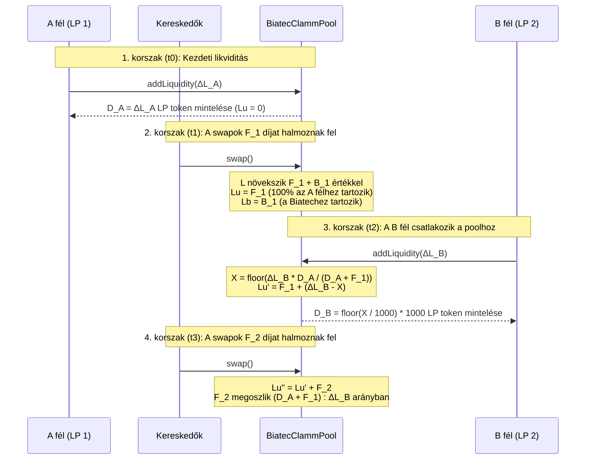
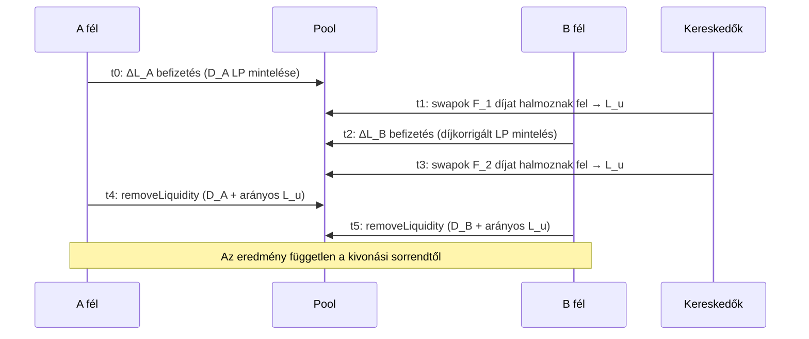

# Több szereplős likviditás-aggregáció és díjméltányossági bizonyítás

Ez a dokumentum tartalmazza a teljes matematikai bizonyítást, a könyvelési modellt, a számszerű példákat és az on-chain tesztellenőrzést, amelyek igazolják, hogy a **Biatec CLAMM** (`BIATEC-CLAMM-01-06-08`) pontosan gyűjti és osztja szét a díjakat akkor is, amikor több felhasználó eltérő időpontokban ad hozzá és von ki likviditást ugyanabban a poolban.

Ez az útmutató konkrétan bizonyítja, hogy:

1. **Nincs díjvesztés**: A swap díjak és a szétosztott staking jutalmak 100%-a láncon belül rögzül, és veszteség nélkül oszlik meg a likviditásszolgáltatók (`LiquidityUsersFromFees`) és a protokoll (`LiquidityBiatecFromFees`) között.
2. **A későn csatlakozók nem tudják lefölözni a korábbi díjakat**: Az a likviditásszolgáltató, aki a díjak felhalmozódása _után_ lép be a poolba, nem tudja kivonni a befizetése előtt keletkezett díjak egyetlen részét sem.
3. **A meglévő LP-k nem hígulnak fel**: A meglévő likviditásszolgáltatók megtartják tőkéjük 100%-át és a korábban felhalmozott díjaik 100%-át, amikor új likviditásszolgáltatók csatlakoznak a poolhoz, és a felhalmozott díjaik automatikusan aktív likviditásként kamatoznak tovább a későbbi kereskedések során.
4. **Kivonási sorrendtől független kifizetések**: Amikor több likviditásszolgáltató lép ki a poolból, az egyes résztvevők kifizetése független attól, hogy ki vonja ki először a tőkéjét (legfeljebb $\le 2$ atomi eszközegységnyi egészosztási lefelé kerekítés erejéig, amely mindig a bent maradó pool javára kerekít).

---

## 1. On-chain könyvelési változók és megmaradási invariáns {#-1-on-chain-accounting-variables--conservation-invariant}

Minden `BiatecClammPool` okosszerződés négy alapvető likviditási mennyiséget tart nyilván 9 tizedesjegyű alapléptékben ($\text{SCALE} = 10^9$):

| Szimbólum | Szerződés állapota / Képlet      | Leírás                                                                                                                                      |
| :-------- | :------------------------------- | :------------------------------------------------------------------------------------------------------------------------------------------ |
| $L$       | `Liquidity` (`L`)                | A nyilvántartott tartalékokból $(x, y) = (\text{assetABalanceBaseScale}, \text{assetBBalanceBaseScale})$ származtatott teljes koncentrált likviditás. |
| $D$       | `distributedLp`                  | A pool számláján kívül forgó LP tokenek mennyisége, 9 tizedesjegyre skálázva: $D = (\text{TOTAL\_SUPPLY} - \text{poolLpBalance}) \times 1000$. |
| $L_u$     | `LiquidityUsersFromFees` (`Lu`)  | A forgalomban lévő LP tokenek tulajdonosait arányosan (pro rata) megillető felhalmozott díj-/jutalom-likviditás.                             |
| $L_b$     | `LiquidityBiatecFromFees` (`Lb`) | A Biatec díjvégrehajtót (`addressExecutiveFee`) megillető felhalmozott protokolldíj-likviditás.                                              |

### Alapvető megmaradási invariáns {#-fundamental-conservation-invariant}

A pool életciklusának minden pontján a teljes görbe-likviditás $L$ teljesíti az alábbi összefüggést:

$$
L = D + L_u + L_b + U
$$

ahol:

- $D + L_u$ az összes LP token tulajdonos teljes likviditási követelése (`removeLiquidity` hívással váltható vissza),
- $L_b$ a protokolldíj-végrehajtó teljes likviditási követelése (`removeLiquidityAdmin` hívással váltható vissza),
- $U$ a mikro-LP alatti egész lefelé kerekítési maradék ($0 \le U < 1000\text{ alapegység} = 10^{-6}\text{ LP}$ betétenként), amely a `reconcileLiquidity` segítségével bármikor jóváírható az $L_u$ számlán (vagy az $L_b$ számlán, ha $D = 0$).

---

## 2. Hogyan történik a díjak begyűjtése minden swapon és jutalomszétosztáson {#-2-how-fees-are-collected-on-every-swap-and-reward-distribution}

### 2.1 Swap díjak felhalmozódása (`swap`) {#-21-swap-fee-accrual-swap}

Amikor egy kereskedő $\Delta_{\text{in}}$ bemeneti összeget swapol (alapléptékben):

1. **Díjlevonás a görbe szerinti árazás előtt**:
   A szerződés kiszámítja a tényleges díjszorzót a pool `fee` paramétere és a kereskedő `BiatecIdentityProvider` szintje alapján:

   $$
   \text{feesMultiplier} = s - \left\lfloor \frac{\text{fee} \cdot \text{user.feeMultiplier}}{\text{user.base}} \right\rfloor, \quad s = 10^9
   $$

   Kizárólag a nettó bemenet $\Delta_{\text{in,afterFee}} = \lfloor \Delta_{\text{in}} \cdot \text{feesMultiplier} / s \rfloor$ vesz részt az ellenoldali eszköz $\Delta_{\text{out}}$ kimenetének kiszámításában az $L_{\text{old}}$ állandó likviditási görbe mentén.

2. **Kimeneti kerekítési védelem**:
   Amikor a $\Delta_{\text{out}}$ értéket a 9 tizedesjegyű alapléptékről a kimeneti eszköz natív tizedeseire váltjuk át, bármilyen nem nulla törtmaradék esetén a kimenet 1 natív eszközegységgel csökken (`realSwapBDecimals = realSwapBDecimals - 1`), garantálva, hogy az egészre kerekítés soha ne csapolja meg a pool tartalékait.

3. **Tartalékok frissítése és a likviditás újraszámítása**:
   A teljes $\Delta_{\text{in}}$ bemenet (beleértve a $\Delta_{\text{in}} - \Delta_{\text{in,afterFee}}$ díjrészt is) hozzáadódik a bejövő tartalékhoz, miközben a kimenő tartalékból csak a ténylegesen kiutalt $\Delta_{\text{out,real}}$ vonódik le. Ezután a szerződés újraszámítja a pool likviditását:

   $$
   L_{\text{new}} = \text{setCurrentLiquidityNonDecreasing}(L_{\text{old}}) \ge L_{\text{old}}
   $$

4. **Maradéktalan díjfelosztás ($\Delta L_u + \Delta L_b = \text{diff}$)**:
   A $\text{diff} = L_{\text{new}} - L_{\text{old}}$ likviditásnövekedés megoszlik az LP-tulajdonosok és a Biatec között:

   $$
   \Delta L_u = \left\lfloor \frac{\text{diff} \cdot (s - f_{\text{biatec}})}{s} \right\rfloor, \quad \Delta L_b = \text{diff} - \Delta L_u
   $$

   Mivel a $\Delta L_b$ definíció szerint $\text{diff} - \Delta L_u$, a $\Delta L_u + \Delta L_b = \text{diff}$ összeg **azonosan** teljesül, nulla kerekítési veszteséggel.

### 2.2 Staking és többlet eszközök szétosztása (`distributeExcessAssets`) {#-22-staking--excess-asset-distribution-distributeexcessassets}

Amikor staking jutalmakat vagy külső hozamot írnak jóvá a `distributeExcessAssets` hívással, a szerződés ellenőrzi a fizikai fedezetet (`ensurePoolBalancesWithinHoldings`), kiszámítja a $\text{diff} = L_{\text{new}} - L_{\text{old}}$ növekedést, és pontosan ugyanezt a maradéktalan $\Delta L_u + \Delta L_b = \text{diff}$ felosztást alkalmazza.

---

## 3. Matematikai bizonyítás: több fél likviditásának aggregálása eltérő időpontokban {#-3-mathematical-proof-aggregating-liquidity-of-multiple-parties-at-different-times}

Tekintsünk két független likviditásszolgáltatót — **A fél (Meglévő LP)** és **B fél (Új belépő)** —, akik eltérő $t_0 < t_2$ időpontokban helyeznek el likviditást ugyanabban a poolban, miközben a B fél belépése előtt ($t_1$) és után ($t_3$) is történnek swapok.



### 1. lépés ($t_0$): Az A fél kezdeti likviditást biztosít {#-step-1-t0-party-a-supplies-initial-liquidity}

Az A fél eszközöket helyez el, amelyek $\Delta L_A$ likviditást adnak egy üres poolhoz ($D_0 = 0, L_{u,0} = 0, L_{b,0} = 0$).

- Az A fél $d_A = \lfloor \Delta L_A / 1000 \rfloor$ mikro-LP tokent kap, ami $D_A = 1000 \, d_A = \Delta L_A - r_A$ alapegységnek felel meg ($0 \le r_A < 1000$).
- A pool állapota $t_0$ után:

  $$
  D_1 = D_A, \quad L_{u,1} = 0, \quad L_{b,1} = 0, \quad L_1 = D_A + r_A
  $$

### 2. lépés ($t_1$): A swapok $F_1$ díjat halmoznak fel, miközben csak az A fél van a poolban {#-step-2-t1-swaps-accrue-fees-f1-while-only-party-a-is-in-the-pool}

A $[t_0, t_1]$ időszakban végrehajtott swapok $F_1 > 0$ felhasználói díjlikviditást és $B_1 \ge 0$ protokolldíj-likviditást termelnek.

- A pool állapota $t_1$-ben:

  $$
  D_1 = D_A, \quad L_{u,1} = F_1, \quad L_{b,1} = B_1, \quad L_1' = D_A + F_1 + B_1 + r_A
  $$

- Mivel az A fél birtokolja a forgalomban lévő LP tokenek 100%-át ($D_1 = D_A$), az A fél visszaváltható likviditási jogosultsága $t_1$-ben:

  $$
  \text{Claim}_A(t_1) = D_A + \left\lfloor \frac{L_{u,1} \cdot D_A}{D_A} \right\rfloor = D_A + F_1
  $$

- A forgalomban lévő LP tokenek minden egyes alapegysége mögött most $\frac{D_A + F_1}{D_A} > 1$ egységnyi felhasználói likviditás áll.

### 3. lépés ($t_2$): A B fél $\Delta L_B$ likviditást helyez el a poolban {#-step-3-t2-party-b-deposits-deltalb-into-the-pool}

A $t_2$ időpontban a B fél eszközöket fizet be, amelyek a pool likviditását $L_1'$-ről $L_2 = L_1' + \Delta L_B$ értékre növelik.

A `processAddLiquidity` metódusban a szerződés kiszámítja a díjakkal korrigált $X_{\text{base}}$ LP mintelési mennyiséget:

$$
X_{\text{base}} = \left\lfloor \frac{\Delta L_B \cdot D_A}{D_A + F_1} \right\rfloor
$$

A B fél számára $d_B = \lfloor X_{\text{base}} / 1000 \rfloor$ mikro-LP token kerül kibocsátásra ($D_B = 1000 \, d_B = X_{\text{base}} - r_B$, ahol $0 \le r_B < 1000$), a nem mintelt $\Delta L_B - X_{\text{base}}$ likviditás pedig jóváírásra kerül a `LiquidityUsersFromFees` számlán:

$$
L_{u,2} = F_1 + (\Delta L_B - X_{\text{base}})
$$

A teljes forgalomban lévő LP mennyiség most $D_2 = D_A + D_B$, a teljes felhasználói tulajdonban lévő likviditás pedig:

$$
D_2 + L_{u,2} = (D_A + X_{\text{base}} - r_B) + (F_1 + \Delta L_B - X_{\text{base}}) = D_A + F_1 + \Delta L_B - r_B
$$

#### 1. tétel (A B fél nem tudja lefölözni a korábban felhalmozott díjakat) {#-theorem-1-party-b-cannot-scoop-pre-existing-fees}

Ha a B fél $t_2^+$ időpontban azonnal meghívja a `removeLiquidity` metódust az összes $D_B$ LP tokenjével, a B fél likviditási kifizetése:

$$
\text{Claim}_B(t_2^+) = D_B + \left\lfloor \frac{L_{u,2} \cdot D_B}{D_A + D_B} \right\rfloor = \left\lfloor \frac{(D_A + D_B + L_{u,2}) \cdot D_B}{D_A + D_B} \right\rfloor
$$

Mivel $D_B \le X_{\text{base}} \le \frac{\Delta L_B \cdot D_A}{D_A + F_1}$, fennáll, hogy:

$$
\frac{D_B}{D_A + D_B} \le \frac{X_{\text{base}}}{D_A + X_{\text{base}}} \le \frac{\Delta L_B}{D_A + F_1 + \Delta L_B}
$$

Beszorozva $D_A + D_B + L_{u,2} = D_A + F_1 + \Delta L_B - r_B \le D_A + F_1 + \Delta L_B$ értékkel:

$$
\text{Claim}_B(t_2^+) \le \Delta L_B
$$

**Következtetés**: A B fél **soha** nem tud több likviditást kivonni, mint $\Delta L_B$ (pontosan annyi likviditást, amennyit befizetett). A B fél **nulla** egységet kap a korábban felhalmozott $F_1$ díjakból.

#### 2. tétel (Az A fél megtartja tőkéje és korábbi díjai 100%-át) {#-theorem-2-party-a-retains-100-of-principal-and-pre-existing-fees}

Közvetlenül a B fél $t_2^+$-beli csatlakozása után az A fél likviditási követelése:

$$
\text{Claim}_A(t_2^+) = D_A + \left\lfloor \frac{L_{u,2} \cdot D_A}{D_A + D_B} \right\rfloor = (D_A + F_1 + \Delta L_B - r_B) - \text{Claim}_B(t_2^+) \ge D_A + F_1
$$

**Következtetés**: Az A fél $\text{Claim}_A(t_2^+)$ jogosultságát **soha nem csökkenti** a B fél befizetése (sőt, legfeljebb $r_B < 1000$ alapegységnyi mikro-LP alatti kerekítéssel nő a pool javára).

### 4. lépés ($t_3$): A későbbi swapok $F_2$ díjat halmoznak fel, miközben mindkét fél a poolban van {#-step-4-t3-subsequent-swaps-accrue-fees-f2-while-both-parties-are-in-the-pool}

A $[t_2, t_3]$ időszakban mind az A fél, mind a B fél tőkéje aktívan biztosít likviditást a poolban:

- Az A fél aktív felhasználói likviditása $t_2$-ben $L_{\text{active},A} = D_A + F_1$ (az A fél kezdeti tőkéje plusz a 2. korszakban felhalmozott és visszaforgatott $F_1$ díjai).
- A B fél aktív felhasználói likviditása $t_2$-ben $L_{\text{active},B} = \Delta L_B$.

Mivel $D_B \approx \frac{\Delta L_B \cdot D_A}{D_A + F_1}$, az A és B fél által birtokolt forgalomban lévő LP tokenek aránya:

$$
\frac{D_A}{D_A + D_B} = \frac{D_A + F_1}{D_A + F_1 + \Delta L_B} = \frac{L_{\text{active},A}}{L_{\text{active},A} + L_{\text{active},B}}
$$

$$
\frac{D_B}{D_A + D_B} = \frac{\Delta L_B}{D_A + F_1 + \Delta L_B} = \frac{L_{\text{active},B}}{L_{\text{active},A} + L_{\text{active},B}}
$$

Amikor a $t_3$-beli új swapok $F_2$ összeget adnak a `LiquidityUsersFromFees` számlához ($L_{u,3} = L_{u,2} + F_2$):

- Az A fél teljes követelése:

  $$
  \text{Claim}_A(t_3) = (D_A + F_1) + \frac{D_A + F_1}{D_A + F_1 + \Delta L_B} F_2
  $$

- A B fél teljes követelése:

  $$
  \text{Claim}_B(t_3) = \Delta L_B + \frac{\Delta L_B}{D_A + F_1 + \Delta L_B} F_2
  $$

**Következtetés**: Az új $F_2$ díjak pontosan az egyes felek $[t_2, t_3]$ alatti aktív likviditásának arányában oszlanak meg, automatikusan kamatos kamatként (compounding) kezelve az A fél korábbi $F_1$ díjbevételét.

### 5. lépés ($t_4, t_5$): Sorrendtől független kivonások (`removeLiquidity`) {#-step-5-t4-t5-order-independent-withdrawals-removeliquidity}

Amikor az $i \in \{A, B\}$ fél elsőként vonja ki $D_i$ LP tokenjeit $t_4$-ben:

1. `lpWithOthers` $= D_A + D_B$.
2. `myPortionOfFeesCollected` $= \lfloor \frac{L_{u,3} \cdot D_i}{D_A + D_B} \rfloor$.
3. `lpDeltaWithFees` $= D_i + \text{myPortionOfFeesCollected} = \text{Claim}_i(t_3)$.
4. A `LiquidityUsersFromFees` értéke $L_{u,4} = L_{u,3} - \text{myPortionOfFeesCollected}$ értékre csökken.
5. A pool $(x, y)$ tartalékai arányosan, $\frac{\text{Claim}_i(t_3)}{L}$ arányban kerülnek kifizetésre, így az $(x, y)$ tartalékok $\frac{L - \text{Claim}_i(t_3)}{L}$ hányada marad a poolban.

Amikor a bent maradó $j \ne i$ fél kivonja $D_j$ LP tokenjeit $t_5$-ben:

1. `lpWithOthers` $= D_j$ (mivel az $i$ fél LP tokenjei $t_4$-ben visszakerültek a poolba).
2. `myPortionOfFeesCollected` $= \lfloor \frac{L_{u,4} \cdot D_j}{D_j} \rfloor = L_{u,4}$.
3. A $j$ fél megkapja a $D_j + L_{u,4} = \text{Claim}_j(t_3)$ összeget, a `LiquidityUsersFromFees` pedig $0$-ra csökken.

---

### Életciklus áttekintése



## 4. Konkrét számszerű példa {#-4-concrete-numerical-example}

Tegyük fel, hogy egy rögzített áras pool ($P = 1.0$, $\text{biatecFee} = 10\%$) az alábbi folyamaton megy keresztül:

1. **1. korszak ($t_0$) — Alice befizet $100\text{ A} + 100\text{ B}$ összeget**:
   - $\Delta L_A = 200 \times 10^9$
   - Alice kap $200,000,000$ mikro-LP-t ($D_A = 200 \times 10^9$).
   - Pool állapota: $L = 200 \times 10^9, \; D = 200 \times 10^9, \; L_u = 0, \; L_b = 0$.

2. **2. korszak ($t_1$) — $20\text{ A} + 20\text{ B}$ ($40 \times 10^9$ likviditás) díj/jutalom halmozódik fel**:
   - $90\%$ a felhasználókat illeti ($\Delta L_u = 36 \times 10^9$), $10\%$ pedig a Biatecet ($\Delta L_b = 4 \times 10^9$).
   - Pool állapota: $L = 240 \times 10^9, \; D = 200 \times 10^9, \; L_u = 36 \times 10^9, \; L_b = 4 \times 10^9$.
   - Alice likviditási jogosultsága $D_A + L_u = 236 \times 10^9$ ($118\text{ A} + 118\text{ B}$).

3. **3. korszak ($t_2$) — Bob befizet $60\text{ A} + 60\text{ B}$ összeget ($\Delta L_B = 120 \times 10^9$ likviditás)**:
   - A szerződés kiszámítja Bob diszkontált LP mintelését:

     $$
     X_{\text{base}} = \left\lfloor \frac{120 \times 10^9 \times 200 \times 10^9}{(200 + 36) \times 10^9} \right\rfloor = 101,694,915,254
     $$

   - Bob kap $d_B = 101,694,915$ mikro-LP-t ($D_B = 101,694,915,000$ alapegység).
   - A nem mintelt díjhígulási ellentételezés $\Delta L_B - X_{\text{base}} = 18,305,084,746$ hozzáadódik az $L_u$-hoz:

     $$
     L_{u,2} = 36 \times 10^9 + 18,305,084,746 = 54,305,084,746
     $$

   - Teljes forgalomban lévő LP: $D_2 = 301,694,915,000$.
   - **Azonnali követelések ellenőrzése $t_2^+$-ban**:
     - Bob követelése: $101,694,915,000 + \lfloor \frac{54,305,084,746 \times 101,694,915,000}{301,694,915,000} \rfloor = 119,999,999,700 \le 120 \times 10^9$ (Bob egyetlen egységet sem tud lefölözni Alice $36 \times 10^9$ díjából).
     - Alice követelése: $200 \times 10^9 + \lfloor \frac{54,305,084,746 \times 200 \times 10^9}{301,694,915,000} \rfloor = 236,000,000,046 \ge 236 \times 10^9$ (Alice megtartja betétje 100%-át és a 2. korszak díjainak 100%-át).

4. **4. korszak ($t_3$) — További $10\text{ A} + 10\text{ B}$ ($20 \times 10^9$ likviditás) díj/jutalom halmozódik fel**:
   - $90\%$ a felhasználókat illeti ($\Delta L_u = 18 \times 10^9$), $10\%$ pedig a Biatecet ($\Delta L_b = 2 \times 10^9$).
   - $L_{u,3} = 54,305,084,746 + 18 \times 10^9 = 72,305,084,746$.
   - Bob részesedése az új $18 \times 10^9$ díjból: $\frac{120}{236 + 120} \times 18 \times 10^9 \approx 6.0674 \times 10^9$ ($\approx 3.0337\text{ A} + 3.0337\text{ B}$).
   - Alice részesedése az új $18 \times 10^9$ díjból: $\frac{236}{236 + 120} \times 18 \times 10^9 \approx 11.9326 \times 10^9$ ($\approx 5.9663\text{ A} + 5.9663\text{ B}$).
   - A Biatec teljes protokolldíja $L_b = 6 \times 10^9$ ($3\text{ A} + 3\text{ B}$).

---

## 5. On-chain tesztcsomag ellenőrzés {#-5-on-chain-test-suite-verification}

Minden több szereplős díj- és likviditás-aggregációs invariánst folyamatosan ellenőriz a Jest tesztcsomag egy élő Algorand LocalNet AVM-en:

| Tesztfájl                                           | Ellenőrzött forgatókönyvek                                                                                                                                                                                                                                                                                                                                                                                                                                                                                                                                                                           |
| :-------------------------------------------------- | :--------------------------------------------------------------------------------------------------------------------------------------------------------------------------------------------------------------------------------------------------------------------------------------------------------------------------------------------------------------------------------------------------------------------------------------------------------------------------------------------------------------------------------------------------------------------------------------------------- |
| `__test__/pool/multi-party-fee-aggregation.test.ts` | **1.** Két, eltérő időpontban csatlakozó LP két swap-korszakon keresztül szigorúan az aktív likviditás $(D_A + L_{u,1}) : \Delta L_B$ arányában osztozik a díjakon.<br/>**2.** Kivonási sorrendtől való függetlenség (Alice először vs. Bob először) és a Biatec protokolldíj ($L_b$) elkülönítése.<br/>**3.** Három LP (Alice, Bob, Charlie) csatlakozása három eltérő időpontban részleges (50%) és teljes kivonásokkal.<br/>**4.** Staking / többleteszköz-jutalom szétosztás (`distributeExcessAssets`) eltérő időpontokban csatlakozó LP-k között.<br/>**5.** Egy második fél által végzett gyors, 5-szörös befizetés/kivonás ciklus soha nem szív el díjakat és nem csökkenti a pool fizikai eszközállományát. |
| `__test__/pool/liquidity.test.ts`                   | A kétirányú swapok után csatlakozó és azonnal kilépő új likviditásszolgáltató nem tudja lefölözni a korábbi díjakat (`deltaA <= 0`, `deltaB <= 0`).                                                                                                                                                                                                                                                                                                                                                                                                                                                  |
| `__test__/pool/mainnet-replay-3720188642.test.ts`   | A `3720188642` Gold/GoldDAO pool teljes, 242 tranzakciós MainNet történetének visszajátszása, amely minden betét, swap és teljes visszaváltás után ellenőrzi az $L = D + L_u + L_b$ megmaradási invariánst.                                                                                                                                                                                                                                                                                                                                                                                          |
| `__test__/pool/reconcile-liquidity.test.ts`         | Annak ellenőrzése, hogy a mikro-LP alatti kerekítési por az $L_u$-ra kerül, amikor $D > 0$, illetve az $L_b$-re, amikor $D = 0$, valamint hogy a `reconcileLiquidity` hívására kizárólag az `addressExecutiveFee` jogosult.                                                                                                                                                                                                                                                                                                                                                                          |
| `__test__/pool/fees.test.ts`                        | Determinisztikus swap díjfelhalmozás, LP kivonás díjakkal, `removeLiquidityAdmin` protokolldíj-kivonás és `distributeExcessAssets` különböző ársávokban.                                                                                                                                                                                                                                                                                                                                                                                                                                             |

### Az ellenőrző tesztcsomag helyi futtatása {#-running-the-verification-suite-locally}

```bash
# Győződjön meg róla, hogy az Algorand LocalNet fut
algokit localnet start

# A dedikált több szereplős díjaggregációs tesztcsomag futtatása
npx jest __test__/pool/multi-party-fee-aggregation.test.ts

# A teljes szerződés-build és az összes tesztcsomag futtatása
npm run test
```

---

## Kapcsolódó dokumentáció {#-related-documentation}

- [Díjfelhalmozás védelme új LP-k belépésekor](./liquidity-fee-protection)
- [Likviditás kerekítés és a nem csökkenő invariáns](./liquidity-rounding)
- [Élő poolok javítása az LP-mintelési javítás után](./live-pool-reconciliation)
- [Staking poolok (kamatot termelő token poolok)](./staking-pools)
