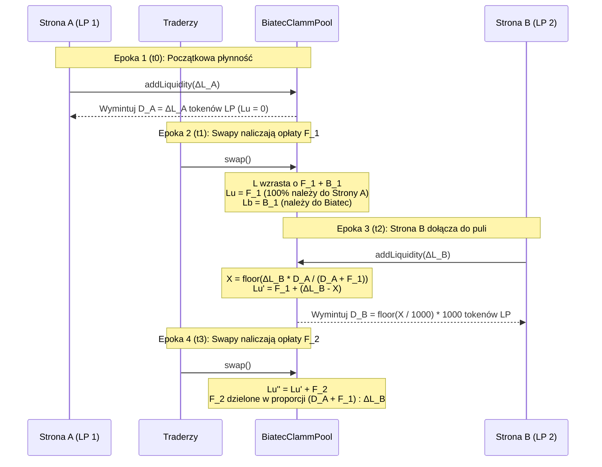
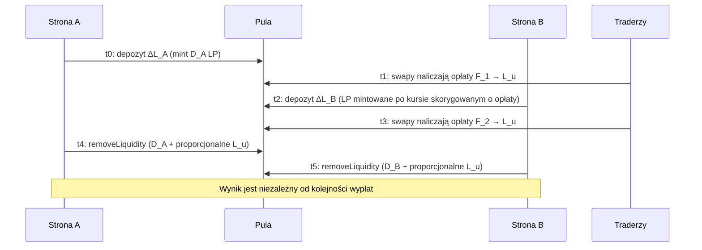

# Agregacja płynności wielu podmiotów i dowód uczciwości opłat

Ten dokument zawiera pełny dowód matematyczny, model księgowy, przykłady liczbowe oraz weryfikację w testach on-chain wykazujące, że **Biatec CLAMM** (`BIATEC-CLAMM-01-06-08`) pobiera i dystrybuuje opłaty w sposób całkowicie dokładny, gdy wielu użytkowników dostarcza i wypłaca płynność w tej samej puli w różnym czasie.

W szczególności niniejszy przewodnik dowodzi, że:

1. **Brak utraty opłat**: 100% opłat transakcyjnych (swap) oraz dystrybuowanych nagród stakingowych jest rejestrowanych on-chain i dzielonych pomiędzy dostawców płynności (`LiquidityUsersFromFees`) a protokół (`LiquidityBiatecFromFees`) bez żadnego nieprzypisanego wycieku.
2. **Brak przejmowania opłat przez późnych uczestników**: Dostawca płynności, który dołącza do puli _po_ naliczeniu opłat, nie może wypłacić żadnej części opłat wypracowanych przed jego depozytem.
3. **Brak rozwodnienia obecnych dostawców płynności (LP)**: Dotychczasowi dostawcy płynności zachowują 100% swojego kapitału początkowego oraz 100% wcześniej naliczonych opłat, gdy do puli dołączają nowi dostawcy płynności, a ich naliczone opłaty automatycznie procentują (compoundują) jako aktywna płynność przy kolejnych transakcjach.
4. **Wypłaty niezależne od kolejności**: Gdy wielu dostawców płynności opuszcza pulę, wypłata dla każdego uczestnika jest niezależna od tego, kto wypłaca jako pierwszy (z dokładnością do $\le 2$ atomowych jednostek aktywa wynikających z całkowitoliczbowego zaokrąglania w dół, które zawsze działa na korzyść puli).

---

## 1. Zmienne księgowe on-chain i niezmiennik zachowania płynności {#-1-on-chain-accounting-variables--conservation-invariant}

Każdy kontrakt `BiatecClammPool` utrzymuje cztery podstawowe wielkości płynności w 9-dziesiętnej skali bazowej ($\text{SCALE} = 10^9$):

| Symbol | Stan kontraktu / Wzór            | Opis                                                                                                                                        |
| :----- | :------------------------------- | :------------------------------------------------------------------------------------------------------------------------------------------ |
| $L$    | `Liquidity` (`L`)                | Całkowita skoncentrowana płynność wyznaczona ze śledzonych rezerw $(x, y) = (\text{assetABalanceBaseScale}, \text{assetBBalanceBaseScale})$. |
| $D$    | `distributedLp`                  | Tokeny LP w obiegu poza kontem puli, przeskalowane do 9 miejsc dziesiętnych: $D = (\text{TOTAL\_SUPPLY} - \text{poolLpBalance}) \times 1000$. |
| $L_u$  | `LiquidityUsersFromFees` (`Lu`)  | Skumulowana płynność z opłat/nagród należąca proporcjonalnie (pro rata) do posiadaczy tokenów LP będących w obiegu.                         |
| $L_b$  | `LiquidityBiatecFromFees` (`Lb`) | Skumulowana płynność opłat protokołu należąca do wykonawcy opłat Biatec (`addressExecutiveFee`).                                             |

### Fundamentalny niezmiennik zachowania płynności {#-fundamental-conservation-invariant}

W każdym punkcie cyklu życia puli całkowita płynność krzywej $L$ spełnia równanie:

$$
L = D + L_u + L_b + U
$$

gdzie:

- $D + L_u$ to całkowite roszczenie płynnościowe wszystkich posiadaczy tokenów LP (do wypłacenia przez `removeLiquidity`),
- $L_b$ to całkowite roszczenie płynnościowe wykonawcy opłat protokołu (do wypłacenia przez `removeLiquidityAdmin`),
- $U$ to reszta z całkowitoliczbowego zaokrąglenia w dół poniżej mikrojednostki LP ($0 \le U < 1000\text{ jednostek bazowych} = 10^{-6}\text{ LP}$ na depozyt), która może zostać w dowolnym momencie dopisana do $L_u$ (lub $L_b$, jeśli $D = 0$) za pomocą `reconcileLiquidity`.

---

## 2. Jak opłaty są pobierane przy każdym swapie i dystrybucji nagród {#-2-how-fees-are-collected-on-every-swap-and-reward-distribution}

### 2.1 Naliczanie opłat transakcyjnych (`swap`) {#-21-swap-fee-accrual-swap}

Gdy trader wymienia kwotę wejściową $\Delta_{\text{in}}$ (w skali bazowej):

1. **Potrącenie opłaty przed wyceną na krzywej**:
   Kontrakt oblicza efektywny mnożnik opłat na podstawie parametru `fee` puli oraz poziomu użytkownika w `BiatecIdentityProvider`:

   $$
   \text{feesMultiplier} = s - \left\lfloor \frac{\text{fee} \cdot \text{user.feeMultiplier}}{\text{user.base}} \right\rfloor, \quad s = 10^9
   $$

   Wyłącznie kwota netto $\Delta_{\text{in,afterFee}} = \lfloor \Delta_{\text{in}} \cdot \text{feesMultiplier} / s \rfloor$ jest używana do obliczenia kwoty wyjściowej drugiego aktywa $\Delta_{\text{out}}$ wzdłuż krzywej stałej płynności $L_{\text{old}}$.

2. **Ochrona zaokrąglania kwoty wyjściowej**:
   Podczas konwersji $\Delta_{\text{out}}$ z 9-dziesiętnej skali bazowej na natywne miejsca dziesiętne aktywa wyjściowego każda niezerowa reszta ułamkowa powoduje zmniejszenie wypłaty o 1 natywną jednostkę aktywa (`realSwapBDecimals = realSwapBDecimals - 1`), dzięki czemu konwersja całkowitoliczbowa nigdy nie uszczupla rezerw puli.

3. **Aktualizacja rezerw i przeliczenie płynności**:
   Pełna kwota wejściowa $\Delta_{\text{in}}$ (wraz z częścią stanowiącą opłatę $\Delta_{\text{in}} - \Delta_{\text{in,afterFee}}$) jest dodawana do rezerwy wejściowej, natomiast od rezerwy wyjściowej odejmowana jest wyłącznie faktycznie przelana kwota $\Delta_{\text{out,real}}$. Następnie kontrakt przelicza płynność puli:

   $$
   L_{\text{new}} = \text{setCurrentLiquidityNonDecreasing}(L_{\text{old}}) \ge L_{\text{old}}
   $$

4. **Wyczerpujący podział opłaty ($\Delta L_u + \Delta L_b = \text{diff}$)**:
   Przyrost płynności $\text{diff} = L_{\text{new}} - L_{\text{old}}$ jest dzielony pomiędzy posiadaczy LP a Biatec:

   $$
   \Delta L_u = \left\lfloor \frac{\text{diff} \cdot (s - f_{\text{biatec}})}{s} \right\rfloor, \quad \Delta L_b = \text{diff} - \Delta L_u
   $$

   Ponieważ $\Delta L_b$ jest zdefiniowane jako $\text{diff} - \Delta L_u$, suma $\Delta L_u + \Delta L_b = \text{diff}$ zachodzi **tożsamościowo**, z zerową stratą na zaokrągleniach.

### 2.2 Dystrybucja nagród stakingowych i nadwyżki aktywów (`distributeExcessAssets`) {#-22-staking--excess-asset-distribution-distributeexcessassets}

Gdy nagrody stakingowe lub zewnętrzny zysk są dopisywane przez `distributeExcessAssets`, kontrakt weryfikuje fizyczne pokrycie w saldach (`ensurePoolBalancesWithinHoldings`), oblicza $\text{diff} = L_{\text{new}} - L_{\text{old}}$ i stosuje identyczny wyczerpujący podział $\Delta L_u + \Delta L_b = \text{diff}$.

---

## 3. Dowód matematyczny: agregacja płynności wielu podmiotów w różnym czasie {#-3-mathematical-proof-aggregating-liquidity-of-multiple-parties-at-different-times}

Rozważmy dwóch niezależnych dostawców płynności — **Stronę A (Dotychczasowy LP)** oraz **Stronę B (Nowy LP)** — którzy wpłacają środki do tej samej puli w różnych momentach $t_0 < t_2$, przy czym swapy odbywają się zarówno przed ($t_1$), jak i po ($t_3$) dołączeniu Strony B.



### Krok 1 ($t_0$): Strona A dostarcza początkową płynność {#-step-1-t0-party-a-supplies-initial-liquidity}

Strona A wpłaca aktywa dodające $\Delta L_A$ płynności do pustej puli ($D_0 = 0, L_{u,0} = 0, L_{b,0} = 0$).

- Strona A otrzymuje $d_A = \lfloor \Delta L_A / 1000 \rfloor$ mikrotokenów LP, co odpowiada $D_A = 1000 \, d_A = \Delta L_A - r_A$ jednostkom bazowym ($0 \le r_A < 1000$).
- Stan puli po $t_0$:

  $$
  D_1 = D_A, \quad L_{u,1} = 0, \quad L_{b,1} = 0, \quad L_1 = D_A + r_A
  $$

### Krok 2 ($t_1$): Swapy naliczają opłaty $F_1$, gdy w puli jest tylko Strona A {#-step-2-t1-swaps-accrue-fees-f1-while-only-party-a-is-in-the-pool}

Swapy w przedziale $[t_0, t_1]$ generują płynność opłat dla użytkowników $F_1 > 0$ oraz płynność opłat protokołu $B_1 \ge 0$.

- Stan puli w chwili $t_1$:

  $$
  D_1 = D_A, \quad L_{u,1} = F_1, \quad L_{b,1} = B_1, \quad L_1' = D_A + F_1 + B_1 + r_A
  $$

- Ponieważ Strona A posiada 100% tokenów LP w obiegu ($D_1 = D_A$), całkowite uprawnienie płynnościowe Strony A w chwili $t_1$ wynosi:

  $$
  \text{Claim}_A(t_1) = D_A + \left\lfloor \frac{L_{u,1} \cdot D_A}{D_A} \right\rfloor = D_A + F_1
  $$

- Każda jednostka bazowa tokenu LP w obiegu ma teraz pokrycie w $\frac{D_A + F_1}{D_A} > 1$ jednostkach płynności użytkowników.

### Krok 3 ($t_2$): Strona B wpłaca $\Delta L_B$ do puli {#-step-3-t2-party-b-deposits-deltalb-into-the-pool}

W chwili $t_2$ Strona B wpłaca aktywa zwiększające płynność puli z $L_1'$ do $L_2 = L_1' + \Delta L_B$.

W metodzie `processAddLiquidity` kontrakt oblicza skorygowaną o opłaty ilość mintowanych tokenów LP $X_{\text{base}}$:

$$
X_{\text{base}} = \left\lfloor \frac{\Delta L_B \cdot D_A}{D_A + F_1} \right\rfloor
$$

Dla Strony B mintowane jest $d_B = \lfloor X_{\text{base}} / 1000 \rfloor$ mikrotokenów LP ($D_B = 1000 \, d_B = X_{\text{base}} - r_B$, gdzie $0 \le r_B < 1000$), a niewymintowana płynność $\Delta L_B - X_{\text{base}}$ zostaje dopisana do `LiquidityUsersFromFees`:

$$
L_{u,2} = F_1 + (\Delta L_B - X_{\text{base}})
$$

Całkowita liczba LP w obiegu wynosi teraz $D_2 = D_A + D_B$, a całkowita płynność należąca do użytkowników to:

$$
D_2 + L_{u,2} = (D_A + X_{\text{base}} - r_B) + (F_1 + \Delta L_B - X_{\text{base}}) = D_A + F_1 + \Delta L_B - r_B
$$

#### Twierdzenie 1 (Strona B nie może przejąć wcześniej naliczonych opłat) {#-theorem-1-party-b-cannot-scoop-pre-existing-fees}

Jeśli Strona B natychmiast wywoła `removeLiquidity` dla wszystkich swoich tokenów $D_B$ w chwili $t_2^+$, wypłata płynności dla Strony B wyniesie:

$$
\text{Claim}_B(t_2^+) = D_B + \left\lfloor \frac{L_{u,2} \cdot D_B}{D_A + D_B} \right\rfloor = \left\lfloor \frac{(D_A + D_B + L_{u,2}) \cdot D_B}{D_A + D_B} \right\rfloor
$$

Ponieważ $D_B \le X_{\text{base}} \le \frac{\Delta L_B \cdot D_A}{D_A + F_1}$, otrzymujemy:

$$
\frac{D_B}{D_A + D_B} \le \frac{X_{\text{base}}}{D_A + X_{\text{base}}} \le \frac{\Delta L_B}{D_A + F_1 + \Delta L_B}
$$

Mnożąc przez $D_A + D_B + L_{u,2} = D_A + F_1 + \Delta L_B - r_B \le D_A + F_1 + \Delta L_B$, uzyskujemy:

$$
\text{Claim}_B(t_2^+) \le \Delta L_B
$$

**Wniosek**: Strona B **nigdy** nie może wypłacić więcej płynności niż $\Delta L_B$ (dokładnie tyle płynności, ile wpłaciła). Strona B otrzymuje **zero** jednostek z wcześniej naliczonych opłat $F_1$.

#### Twierdzenie 2 (Strona A zachowuje 100% kapitału oraz wcześniej naliczonych opłat) {#-theorem-2-party-a-retains-100-of-principal-and-pre-existing-fees}

Bezpośrednio po dołączeniu Strony B w chwili $t_2^+$ roszczenie płynnościowe Strony A wynosi:

$$
\text{Claim}_A(t_2^+) = D_A + \left\lfloor \frac{L_{u,2} \cdot D_A}{D_A + D_B} \right\rfloor = (D_A + F_1 + \Delta L_B - r_B) - \text{Claim}_B(t_2^+) \ge D_A + F_1
$$

**Wniosek**: Uprawnienie Strony A $\text{Claim}_A(t_2^+)$ **nigdy nie ulega zmniejszeniu** wskutek depozytu Strony B (a wręcz wzrasta o maksymalnie $r_B < 1000$ jednostek bazowych zaokrąglenia na korzyść puli).

### Krok 4 ($t_3$): Kolejne swapy naliczają opłaty $F_2$, gdy obie strony są w puli {#-step-4-t3-subsequent-swaps-accrue-fees-f2-while-both-parties-are-in-the-pool}

W przedziale $[t_2, t_3]$ zarówno Strona A, jak i Strona B posiadają kapitał aktywnie zapewniający płynność w puli:

- Aktywna płynność Strony A w chwili $t_2$ wynosi $L_{\text{active},A} = D_A + F_1$ (początkowy kapitał Strony A powiększony o skapitalizowane opłaty $F_1$ z Epoki 2).
- Aktywna płynność Strony B w chwili $t_2$ wynosi $L_{\text{active},B} = \Delta L_B$.

Ponieważ $D_B \approx \frac{\Delta L_B \cdot D_A}{D_A + F_1}$, stosunek tokenów LP w obiegu posiadanych przez Stronę A i Stronę B spełnia zależności:

$$
\frac{D_A}{D_A + D_B} = \frac{D_A + F_1}{D_A + F_1 + \Delta L_B} = \frac{L_{\text{active},A}}{L_{\text{active},A} + L_{\text{active},B}}
$$

$$
\frac{D_B}{D_A + D_B} = \frac{\Delta L_B}{D_A + F_1 + \Delta L_B} = \frac{L_{\text{active},B}}{L_{\text{active},A} + L_{\text{active},B}}
$$

Gdy nowe swapy w chwili $t_3$ dodają $F_2$ do `LiquidityUsersFromFees` ($L_{u,3} = L_{u,2} + F_2$):

- Całkowite roszczenie Strony A wynosi:

  $$
  \text{Claim}_A(t_3) = (D_A + F_1) + \frac{D_A + F_1}{D_A + F_1 + \Delta L_B} F_2
  $$

- Całkowite roszczenie Strony B wynosi:

  $$
  \text{Claim}_B(t_3) = \Delta L_B + \frac{\Delta L_B}{D_A + F_1 + \Delta L_B} F_2
  $$

**Wniosek**: Nowe opłaty $F_2$ są rozdzielane dokładnie proporcjonalnie do aktywnej płynności każdej ze stron w puli w okresie $[t_2, t_3]$, automatycznie kapitalizując wcześniejsze zyski z opłat $F_1$ Strony A.

### Krok 5 ($t_4, t_5$): Wypłaty niezależne od kolejności (`removeLiquidity`) {#-step-5-t4-t5-order-independent-withdrawals-removeliquidity}

Gdy Strona $i \in \{A, B\}$ wypłaca swoje tokeny LP $D_i$ jako pierwsza w chwili $t_4$:

1. `lpWithOthers` $= D_A + D_B$.
2. `myPortionOfFeesCollected` $= \lfloor \frac{L_{u,3} \cdot D_i}{D_A + D_B} \rfloor$.
3. `lpDeltaWithFees` $= D_i + \text{myPortionOfFeesCollected} = \text{Claim}_i(t_3)$.
4. `LiquidityUsersFromFees` zostaje pomniejszone do $L_{u,4} = L_{u,3} - \text{myPortionOfFeesCollected}$.
5. Rezerwy puli $(x, y)$ są wypłacane proporcjonalnie według współczynnika $\frac{\text{Claim}_i(t_3)}{L}$, pozostawiając $\frac{L - \text{Claim}_i(t_3)}{L}$ rezerw $(x, y)$ w puli.

Gdy pozostała Strona $j \ne i$ wypłaca swoje tokeny LP $D_j$ w chwili $t_5$:

1. `lpWithOthers` $= D_j$ (ponieważ tokeny LP Strony $i$ wróciły do puli w chwili $t_4$).
2. `myPortionOfFeesCollected` $= \lfloor \frac{L_{u,4} \cdot D_j}{D_j} \rfloor = L_{u,4}$.
3. Strona $j$ otrzymuje $D_j + L_{u,4} = \text{Claim}_j(t_3)$, a `LiquidityUsersFromFees` spada do $0$.

---

### Przegląd cyklu życia



## 4. Konkretny przykład liczbowy {#-4-concrete-numerical-example}

Załóżmy, że pula o stałej cenie ($P = 1.0$, $\text{biatecFee} = 10\%$) przechodzi przez następującą sekwencję zdarzeń:

1. **Epoka 1 ($t_0$) — Alice wpłaca $100\text{ A} + 100\text{ B}$**:
   - $\Delta L_A = 200 \times 10^9$
   - Alice otrzymuje $200,000,000$ mikro-LP ($D_A = 200 \times 10^9$).
   - Stan puli: $L = 200 \times 10^9, \; D = 200 \times 10^9, \; L_u = 0, \; L_b = 0$.

2. **Epoka 2 ($t_1$) — Naliczane są opłaty/nagrody w wysokości $20\text{ A} + 20\text{ B}$ ($40 \times 10^9$ płynności)**:
   - $90\%$ trafia do użytkowników ($\Delta L_u = 36 \times 10^9$), a $10\%$ trafia do Biatec ($\Delta L_b = 4 \times 10^9$).
   - Stan puli: $L = 240 \times 10^9, \; D = 200 \times 10^9, \; L_u = 36 \times 10^9, \; L_b = 4 \times 10^9$.
   - Uprawnienie płynnościowe Alice wynosi $D_A + L_u = 236 \times 10^9$ ($118\text{ A} + 118\text{ B}$).

3. **Epoka 3 ($t_2$) — Bob wpłaca $60\text{ A} + 60\text{ B}$ ($\Delta L_B = 120 \times 10^9$ płynności)**:
   - Kontrakt oblicza zdyskontowaną ilość LP do wymintowania dla Boba:

     $$
     X_{\text{base}} = \left\lfloor \frac{120 \times 10^9 \times 200 \times 10^9}{(200 + 36) \times 10^9} \right\rfloor = 101,694,915,254
     $$

   - Bob otrzymuje $d_B = 101,694,915$ mikro-LP ($D_B = 101,694,915,000$ jednostek bazowych).
   - Niewymintowana korekta rozwodnienia opłat $\Delta L_B - X_{\text{base}} = 18,305,084,746$ zostaje dodana do $L_u$:

     $$
     L_{u,2} = 36 \times 10^9 + 18,305,084,746 = 54,305,084,746
     $$

   - Całkowita liczba LP w obiegu: $D_2 = 301,694,915,000$.
   - **Sprawdzenie natychmiastowych roszczeń w chwili $t_2^+$**:
     - Roszczenie Boba: $101,694,915,000 + \lfloor \frac{54,305,084,746 \times 101,694,915,000}{301,694,915,000} \rfloor = 119,999,999,700 \le 120 \times 10^9$ (Bob nie może przejąć żadnej części z $36 \times 10^9$ opłat Alice).
     - Roszczenie Alice: $200 \times 10^9 + \lfloor \frac{54,305,084,746 \times 200 \times 10^9}{301,694,915,000} \rfloor = 236,000,000,046 \ge 236 \times 10^9$ (Alice zachowuje 100% swojego depozytu oraz 100% opłat z Epoki 2).

4. **Epoka 4 ($t_3$) — Naliczane są dodatkowe opłaty/nagrody w wysokości $10\text{ A} + 10\text{ B}$ ($20 \times 10^9$ płynności)**:
   - $90\%$ trafia do użytkowników ($\Delta L_u = 18 \times 10^9$), a $10\%$ trafia do Biatec ($\Delta L_b = 2 \times 10^9$).
   - $L_{u,3} = 54,305,084,746 + 18 \times 10^9 = 72,305,084,746$.
   - Udział Boba w nowych opłatach $18 \times 10^9$ wynosi $\frac{120}{236 + 120} \times 18 \times 10^9 \approx 6.0674 \times 10^9$ ($\approx 3.0337\text{ A} + 3.0337\text{ B}$).
   - Udział Alice w nowych opłatach $18 \times 10^9$ wynosi $\frac{236}{236 + 120} \times 18 \times 10^9 \approx 11.9326 \times 10^9$ ($\approx 5.9663\text{ A} + 5.9663\text{ B}$).
   - Całkowita opłata protokołu Biatec wynosi $L_b = 6 \times 10^9$ ($3\text{ A} + 3\text{ B}$).

---

## 5. Weryfikacja w zestawach testów on-chain {#-5-on-chain-test-suite-verification}

Wszystkie niezmienniki dotyczące opłat i agregacji płynności wielu podmiotów są stale weryfikowane na żywej maszynie wirtualnej Algorand LocalNet AVM w zestawach testów Jest:

| Plik testowy                                        | Zweryfikowane scenariusze                                                                                                                                                                                                                                                                                                                                                                                                                                                                                                                                                                            |
| :-------------------------------------------------- | :--------------------------------------------------------------------------------------------------------------------------------------------------------------------------------------------------------------------------------------------------------------------------------------------------------------------------------------------------------------------------------------------------------------------------------------------------------------------------------------------------------------------------------------------------------------------------------------------------- |
| `__test__/pool/multi-party-fee-aggregation.test.ts` | **1.** Dwóch dostawców płynności (LP) dołączających w różnym czasie w trakcie dwóch epok swapów dzieli się opłatami ściśle proporcjonalnie do aktywnej płynności $(D_A + L_{u,1}) : \Delta L_B$.<br/>**2.** Niezależność wypłat od kolejności (najpierw Alice vs. najpierw Bob) oraz izolacja opłat protokołu Biatec ($L_b$).<br/>**3.** Trzech LP (Alice, Bob, Charlie) dołączających w trzech różnych momentach z częściowymi (50%) i pełnymi wypłatami.<br/>**4.** Dystrybucja nagród stakingowych / nadwyżki aktywów (`distributeExcessAssets`) pomiędzy wielu LP dołączających w różnym czasie.<br/>**5.** Szybkie 5-krotne cykle wpłat i wypłat wykonywane przez drugi podmiot nigdy nie przejmują opłat ani nie zmniejszają fizycznych zasobów puli. |
| `__test__/pool/liquidity.test.ts`                   | Nowy dostawca płynności dołączający po dwukierunkowych swapach i natychmiast wypłacający środki nie może przejąć wcześniej naliczonych opłat (`deltaA <= 0`, `deltaB <= 0`).                                                                                                                                                                                                                                                                                                                                                                                                                        |
| `__test__/pool/mainnet-replay-3720188642.test.ts`   | Pełne odtworzenie 242 transakcji z historii MainNet puli Gold/GoldDAO `3720188642` weryfikujące zachowanie równania $L = D + L_u + L_b$ po każdym depozycie, swapie i pełnym umorzeniu.                                                                                                                                                                                                                                                                                                                                                                                                              |
| `__test__/pool/reconcile-liquidity.test.ts`         | Weryfikacja, że pył z zaokrąglania poniżej mikrojednostki LP trafia do $L_u$, gdy $D > 0$, oraz do $L_b$, gdy $D = 0$, a także że wywołanie `reconcileLiquidity` jest ograniczone wyłącznie do `addressExecutiveFee`.                                                                                                                                                                                                                                                                                                                                                                                |
| `__test__/pool/fees.test.ts`                        | Deterministyczne naliczanie opłat swap, wypłata LP wraz z opłatami, pobieranie opłat protokołu przez `removeLiquidityAdmin` oraz `distributeExcessAssets` w różnych przedziałach cenowych.                                                                                                                                                                                                                                                                                                                                                                                                           |

### Lokalne uruchomienie zestawu weryfikacyjnego {#-running-the-verification-suite-locally}

```bash
# Upewnij się, że Algorand LocalNet jest uruchomiony
algokit localnet start

# Uruchom dedykowany zestaw testów agregacji opłat wielu podmiotów
npx jest __test__/pool/multi-party-fee-aggregation.test.ts

# Uruchom pełne budowanie kontraktów oraz cały zestaw testów
npm run test
```

---

## Powiązana dokumentacja {#-related-documentation}

- [Ochrona akumulacji opłat gdy dołączają nowi LP](./liquidity-fee-protection)
- [Zaokrąglanie płynności i niezmniejszający się niezmiennik](./liquidity-rounding)
- [Naprawa działających pul po poprawce mintowania LP](./live-pool-reconciliation)
- [Pule stakingowe (Pule z oprocentowanymi tokenami)](./staking-pools)
