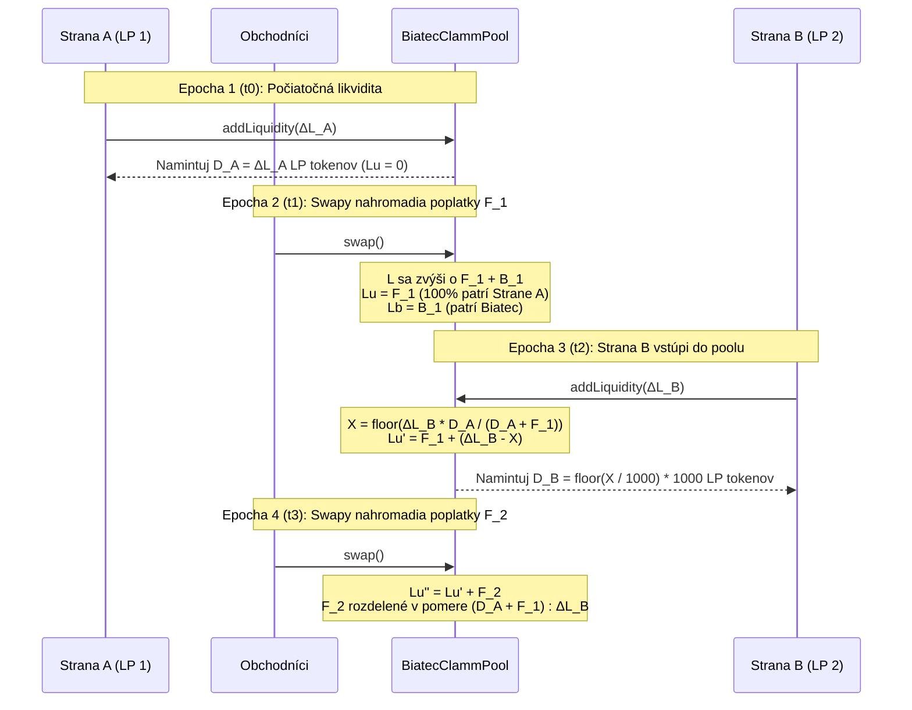
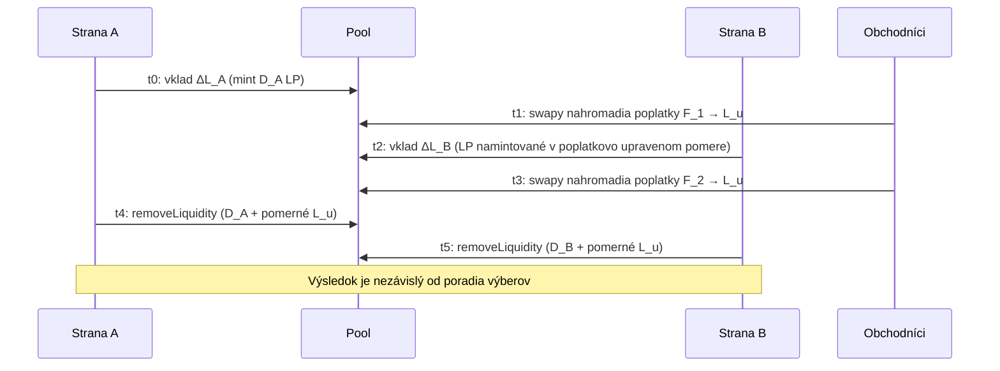

# Agregácia likvidity viacerých strán a dôkaz spravodlivosti poplatkov

Tento dokument poskytuje kompletný matematický dôkaz, účtovný model, číselné príklady a on-chain testovacie overenie dokazujúce, že **Biatec CLAMM** (`BIATEC-CLAMM-01-06-08`) vyberá a rozdeľuje poplatky presne aj vtedy, keď viacerí používatelia vkladajú a vyberajú likviditu v tom istom poole v rôznych časoch.

Konkrétne táto príručka dokazuje, že:

1. **Žiadna strata poplatkov**: 100% poplatkov zo swapov a distribuovaných staking odmien je zachytených on-chain a rozdelených medzi poskytovateľov likvidity (`LiquidityUsersFromFees`) a protokol (`LiquidityBiatecFromFees`) s nulovým nepriradeným únikom.
2. **Žiadne odčerpanie poplatkov neskoršími účastníkmi**: Poskytovateľ likvidity, ktorý vstúpi do poolu _po_ nahromadení poplatkov, nemôže odčerpať žiadnu časť poplatkov zarobených pred jeho vkladom.
3. **Žiadne zriedenie existujúcich LP**: Existujúci poskytovatelia likvidity si zachovávajú 100% svojej istiny a 100% svojich predtým nahromadených poplatkov, keď do poolu vstúpia noví poskytovatelia likvidity, a ich nahromadené poplatky sa automaticky zložene úročia (compoundujú) ako aktívna likvidita pre nasledujúce obchody.
4. **Výbery nezávislé od poradia**: Keď z poolu vystupuje viacero poskytovateľov likvidity, výplata pre každého účastníka je nezávislá od toho, kto vyberá ako prvý (s presnosťou na $\le 2$ atomické jednotky aktíva z celočíselného zaokrúhľovania nadol, ktoré vždy zaokrúhľuje v prospech zostávajúceho poolu).

---

## 1. On-chain účtovné premenné a zákon zachovania likvidity {#-1-on-chain-accounting-variables--conservation-invariant}

Každý kontrakt `BiatecClammPool` udržiava štyri základné veličiny likvidity v 9-desatinnej základnej škále ($\text{SCALE} = 10^9$):

| Symbol | Stav kontraktu / Vzorec          | Popis                                                                                                                                       |
| :----- | :------------------------------- | :------------------------------------------------------------------------------------------------------------------------------------------ |
| $L$    | `Liquidity` (`L`)                | Celková koncentrovaná likvidita odvodená zo sledovaných rezerv $(x, y) = (\text{assetABalanceBaseScale}, \text{assetBBalanceBaseScale})$.    |
| $D$    | `distributedLp`                  | LP tokeny v obehu mimo účtu poolu, preškálované na 9 desatinných miest: $D = (\text{TOTAL\_SUPPLY} - \text{poolLpBalance}) \times 1000$.     |
| $L_u$  | `LiquidityUsersFromFees` (`Lu`)  | Nahromadená likvidita z poplatkov/odmien vlastnená pomerne (pro rata) držiteľmi LP tokenov v obehu.                                          |
| $L_b$  | `LiquidityBiatecFromFees` (`Lb`) | Nahromadená likvidita protokolových poplatkov vlastnená exekútorom poplatkov Biatec (`addressExecutiveFee`).                                 |

### Základný invariant zachovania likvidity {#-fundamental-conservation-invariant}

V každom okamihu životného cyklu poolu celková likvidita krivky $L$ spĺňa:

$$
L = D + L_u + L_b + U
$$

kde:

- $D + L_u$ je celkový nárok na likviditu všetkých držiteľov LP tokenov (vyberateľný cez `removeLiquidity`),
- $L_b$ je celkový nárok na likviditu exekútora protokolových poplatkov (vyberateľný cez `removeLiquidityAdmin`),
- $U$ je zvyšok z celočíselného zaokrúhlenia nadol pod úrovňou mikro-LP ($0 \le U < 1000\text{ základných jednotiek} = 10^{-6}\text{ LP}$ na vklad), ktorý možno kedykoľvek pripísať do $L_u$ (alebo $L_b$, ak $D = 0$) pomocou `reconcileLiquidity`.

---

## 2. Ako sa zbierajú poplatky pri každom swape a distribúcii odmien {#-2-how-fees-are-collected-on-every-swap-and-reward-distribution}

### 2.1 Narastanie poplatkov zo swapu (`swap`) {#-21-swap-fee-accrual-swap}

Keď obchodník vymieňa vstupnú sumu $\Delta_{\text{in}}$ (v základnej škále):

1. **Odpočítanie poplatku pred ocenením na krivke**:
   Kontrakt vypočíta efektívny násobiteľ poplatkov z parametra `fee` poolu a úrovne obchodníka v `BiatecIdentityProvider`:

   $$
   \text{feesMultiplier} = s - \left\lfloor \frac{\text{fee} \cdot \text{user.feeMultiplier}}{\text{user.base}} \right\rfloor, \quad s = 10^9
   $$

   Iba čistý vstup $\Delta_{\text{in,afterFee}} = \lfloor \Delta_{\text{in}} \cdot \text{feesMultiplier} / s \rfloor$ sa použije na výpočet výstupu protistranného aktíva $\Delta_{\text{out}}$ pozdĺž krivky konštantnej likvidity $L_{\text{old}}$.

2. **Ochrana zaokrúhľovania výstupu**:
   Pri konverzii $\Delta_{\text{out}}$ z 9-desatinnej základnej škály na natívne desatinné miesta výstupného aktíva akýkoľvek nenulový desatinný zvyšok spôsobí zníženie výstupu o 1 natívnu jednotku aktíva (`realSwapBDecimals = realSwapBDecimals - 1`), čím sa zaručí, že celočíselná konverzia nikdy neodčerpá rezervy poolu.

3. **Aktualizácia rezerv a prepočítanie likvidity**:
   Celý vstup $\Delta_{\text{in}}$ (vrátane poplatkovej časti $\Delta_{\text{in}} - \Delta_{\text{in,afterFee}}$) sa pripočíta k vstupnej rezerve, zatiaľ čo z výstupnej rezervy sa odpočíta iba skutočne prevedený výstup $\Delta_{\text{out,real}}$. Kontrakt následne prepočíta likviditu poolu:

   $$
   L_{\text{new}} = \text{setCurrentLiquidityNonDecreasing}(L_{\text{old}}) \ge L_{\text{old}}
   $$

4. **Bezozvyškové rozdelenie poplatku ($\Delta L_u + \Delta L_b = \text{diff}$)**:
   Prírastok likvidity $\text{diff} = L_{\text{new}} - L_{\text{old}}$ sa rozdelí medzi držiteľov LP a Biatec:

   $$
   \Delta L_u = \left\lfloor \frac{\text{diff} \cdot (s - f_{\text{biatec}})}{s} \right\rfloor, \quad \Delta L_b = \text{diff} - \Delta L_u
   $$

   Pretože $\Delta L_b$ je definované ako $\text{diff} - \Delta L_u$, súčet $\Delta L_u + \Delta L_b = \text{diff}$ platí **identicky** s nulovou stratou zo zaokrúhľovania.

### 2.2 Staking a distribúcia prebytočných aktív (`distributeExcessAssets`) {#-22-staking--excess-asset-distribution-distributeexcessassets}

Keď sa staking odmeny alebo externý výnos pripisujú cez `distributeExcessAssets`, kontrakt overí fyzické krytie (`ensurePoolBalancesWithinHoldings`), vypočíta $\text{diff} = L_{\text{new}} - L_{\text{old}}$ a použije identické bezozvyškové rozdelenie $\Delta L_u + \Delta L_b = \text{diff}$.

---

## 3. Matematický dôkaz: agregácia likvidity viacerých strán v rôznych časoch {#-3-mathematical-proof-aggregating-liquidity-of-multiple-parties-at-different-times}

Uvažujme dvoch nezávislých poskytovateľov likvidity — **Stranu A (Existujúci LP)** a **Stranu B (Nový LP)** — ktorí vložia prostriedky do toho istého poolu v rôznych časoch $t_0 < t_2$, pričom swapy prebiehajú pred ($t_1$) aj po ($t_3$) vstupe Strany B.



### Krok 1 ($t_0$): Strana A dodá počiatočnú likviditu {#-step-1-t0-party-a-supplies-initial-liquidity}

Strana A vloží aktíva pridávajúce $\Delta L_A$ likvidity do prázdneho poolu ($D_0 = 0, L_{u,0} = 0, L_{b,0} = 0$).

- Strana A dostane $d_A = \lfloor \Delta L_A / 1000 \rfloor$ mikro-LP tokenov, čo zodpovedá $D_A = 1000 \, d_A = \Delta L_A - r_A$ základným jednotkám ($0 \le r_A < 1000$).
- Stav poolu po $t_0$:

  $$
  D_1 = D_A, \quad L_{u,1} = 0, \quad L_{b,1} = 0, \quad L_1 = D_A + r_A
  $$

### Krok 2 ($t_1$): Swapy nahromadia poplatky $F_1$, kým je v poole iba Strana A {#-step-2-t1-swaps-accrue-fees-f1-while-only-party-a-is-in-the-pool}

Swapy počas $[t_0, t_1]$ vytvoria používateľskú poplatkovú likviditu $F_1 > 0$ a protokolovú poplatkovú likviditu $B_1 \ge 0$.

- Stav poolu v čase $t_1$:

  $$
  D_1 = D_A, \quad L_{u,1} = F_1, \quad L_{b,1} = B_1, \quad L_1' = D_A + F_1 + B_1 + r_A
  $$

- Keďže Strana A drží 100% LP tokenov v obehu ($D_1 = D_A$), vyberateľný nárok Strany A na likviditu v čase $t_1$ je:

  $$
  \text{Claim}_A(t_1) = D_A + \left\lfloor \frac{L_{u,1} \cdot D_A}{D_A} \right\rfloor = D_A + F_1
  $$

- Každá základná jednotka LP tokenu v obehu je teraz krytá $\frac{D_A + F_1}{D_A} > 1$ jednotkami používateľskej likvidity.

### Krok 3 ($t_2$): Strana B vloží $\Delta L_B$ do poolu {#-step-3-t2-party-b-deposits-deltalb-into-the-pool}

V čase $t_2$ Strana B vloží aktíva, ktoré zvýšia likviditu poolu z $L_1'$ na $L_2 = L_1' + \Delta L_B$.

V metóde `processAddLiquidity` kontrakt vypočíta poplatkovo upravené množstvo mintovaných LP $X_{\text{base}}$:

$$
X_{\text{base}} = \left\lfloor \frac{\Delta L_B \cdot D_A}{D_A + F_1} \right\rfloor
$$

Pre Stranu B sa namintuje $d_B = \lfloor X_{\text{base}} / 1000 \rfloor$ mikro-LP tokenov ($D_B = 1000 \, d_B = X_{\text{base}} - r_B$, kde $0 \le r_B < 1000$) a nenamintovaná likvidita $\Delta L_B - X_{\text{base}}$ sa pripíše do `LiquidityUsersFromFees`:

$$
L_{u,2} = F_1 + (\Delta L_B - X_{\text{base}})
$$

Celkové množstvo LP v obehu je teraz $D_2 = D_A + D_B$ a celková likvidita vlastnená používateľmi je:

$$
D_2 + L_{u,2} = (D_A + X_{\text{base}} - r_B) + (F_1 + \Delta L_B - X_{\text{base}}) = D_A + F_1 + \Delta L_B - r_B
$$

#### Veta 1 (Strana B nemôže odčerpať predtým nahromadené poplatky) {#-theorem-1-party-b-cannot-scoop-pre-existing-fees}

Ak Strana B okamžite zavolá `removeLiquidity` so všetkými $D_B$ LP tokenmi v čase $t_2^+$, výplata likvidity pre Stranu B je:

$$
\text{Claim}_B(t_2^+) = D_B + \left\lfloor \frac{L_{u,2} \cdot D_B}{D_A + D_B} \right\rfloor = \left\lfloor \frac{(D_A + D_B + L_{u,2}) \cdot D_B}{D_A + D_B} \right\rfloor
$$

Pretože $D_B \le X_{\text{base}} \le \frac{\Delta L_B \cdot D_A}{D_A + F_1}$, platí:

$$
\frac{D_B}{D_A + D_B} \le \frac{X_{\text{base}}}{D_A + X_{\text{base}}} \le \frac{\Delta L_B}{D_A + F_1 + \Delta L_B}
$$

Vynásobením hodnotou $D_A + D_B + L_{u,2} = D_A + F_1 + \Delta L_B - r_B \le D_A + F_1 + \Delta L_B$ dostávame:

$$
\text{Claim}_B(t_2^+) \le \Delta L_B
$$

**Záver**: Strana B **nikdy** nemôže vybrať viac likvidity ako $\Delta L_B$ (presne tú likviditu, ktorú Strana B vložila). Strana B dostane **nula** jednotiek z predtým nahromadených poplatkov $F_1$.

#### Veta 2 (Strana A si zachováva 100% istiny a predtým nahromadených poplatkov) {#-theorem-2-party-a-retains-100-of-principal-and-pre-existing-fees}

Bezprostredne po vstupe Strany B v čase $t_2^+$ je nárok Strany A na likviditu:

$$
\text{Claim}_A(t_2^+) = D_A + \left\lfloor \frac{L_{u,2} \cdot D_A}{D_A + D_B} \right\rfloor = (D_A + F_1 + \Delta L_B - r_B) - \text{Claim}_B(t_2^+) \ge D_A + F_1
$$

**Záver**: Nárok Strany A $\text{Claim}_A(t_2^+)$ sa vkladom Strany B **nikdy nezníži** (a zvýši sa najviac o $r_B < 1000$ základných jednotiek zaokrúhlenia pod mikro-LP v prospech poolu).

### Krok 4 ($t_3$): Následné swapy nahromadia poplatky $F_2$, kým sú obe strany v poole {#-step-4-t3-subsequent-swaps-accrue-fees-f2-while-both-parties-are-in-the-pool}

Počas $[t_2, t_3]$ majú Strana A aj Strana B kapitál, ktorý aktívne poskytuje likviditu v poole:

- Aktívna používateľská likvidita Strany A v čase $t_2$ je $L_{\text{active},A} = D_A + F_1$ (počiatočná istina Strany A plus jej zložené poplatky $F_1$ z Epochy 2).
- Aktívna používateľská likvidita Strany B v čase $t_2$ je $L_{\text{active},B} = \Delta L_B$.

Pretože $D_B \approx \frac{\Delta L_B \cdot D_A}{D_A + F_1}$, pomer LP tokenov v obehu držaných Stranou A a Stranou B spĺňa:

$$
\frac{D_A}{D_A + D_B} = \frac{D_A + F_1}{D_A + F_1 + \Delta L_B} = \frac{L_{\text{active},A}}{L_{\text{active},A} + L_{\text{active},B}}
$$

$$
\frac{D_B}{D_A + D_B} = \frac{\Delta L_B}{D_A + F_1 + \Delta L_B} = \frac{L_{\text{active},B}}{L_{\text{active},A} + L_{\text{active},B}}
$$

Keď nové swapy v čase $t_3$ pridajú $F_2$ do `LiquidityUsersFromFees` ($L_{u,3} = L_{u,2} + F_2$):

- Celkový nárok Strany A sa stáva:

  $$
  \text{Claim}_A(t_3) = (D_A + F_1) + \frac{D_A + F_1}{D_A + F_1 + \Delta L_B} F_2
  $$

- Celkový nárok Strany B sa stáva:

  $$
  \text{Claim}_B(t_3) = \Delta L_B + \frac{\Delta L_B}{D_A + F_1 + \Delta L_B} F_2
  $$

**Záver**: Nové poplatky $F_2$ sa rozdeľujú v presnom pomere k aktívnej likvidite každej strany v poole počas $[t_2, t_3]$, čím sa automaticky zložene úročia (compoundujú) predchádzajúce výnosy z poplatkov $F_1$ Strany A.

### Krok 5 ($t_4, t_5$): Výbery nezávislé od poradia (`removeLiquidity`) {#-step-5-t4-t5-order-independent-withdrawals-removeliquidity}

Keď Strana $i \in \{A, B\}$ vyberie svoje LP tokeny $D_i$ ako prvá v čase $t_4$:

1. `lpWithOthers` $= D_A + D_B$.
2. `myPortionOfFeesCollected` $= \lfloor \frac{L_{u,3} \cdot D_i}{D_A + D_B} \rfloor$.
3. `lpDeltaWithFees` $= D_i + \text{myPortionOfFeesCollected} = \text{Claim}_i(t_3)$.
4. `LiquidityUsersFromFees` sa zníži na $L_{u,4} = L_{u,3} - \text{myPortionOfFeesCollected}$.
5. Rezervy poolu $(x, y)$ sa vyplatia pomerne podľa $\frac{\text{Claim}_i(t_3)}{L}$, pričom v poole zostane $\frac{L - \text{Claim}_i(t_3)}{L}$ rezerv $(x, y)$.

Keď zostávajúca Strana $j \ne i$ vyberie svoje LP tokeny $D_j$ v čase $t_5$:

1. `lpWithOthers` $= D_j$ (pretože LP tokeny Strany $i$ boli vrátené do poolu v čase $t_4$).
2. `myPortionOfFeesCollected` $= \lfloor \frac{L_{u,4} \cdot D_j}{D_j} \rfloor = L_{u,4}$.
3. Strana $j$ dostane $D_j + L_{u,4} = \text{Claim}_j(t_3)$ a `LiquidityUsersFromFees` klesne na $0$.

---

### Prehľad životného cyklu



## 4. Konkrétny číselný príklad {#-4-concrete-numerical-example}

Predpokladajme, že pool s pevnou cenou ($P = 1.0$, $\text{biatecFee} = 10\%$) prejde nasledujúcou postupnosťou:

1. **Epocha 1 ($t_0$) — Alice vloží $100\text{ A} + 100\text{ B}$**:
   - $\Delta L_A = 200 \times 10^9$
   - Alice dostane $200,000,000$ mikro-LP ($D_A = 200 \times 10^9$).
   - Stav poolu: $L = 200 \times 10^9, \; D = 200 \times 10^9, \; L_u = 0, \; L_b = 0$.

2. **Epocha 2 ($t_1$) — Nahromadia sa poplatky/odmeny vo výške $20\text{ A} + 20\text{ B}$ ($40 \times 10^9$ likvidity)**:
   - $90\%$ ide používateľom ($\Delta L_u = 36 \times 10^9$) a $10\%$ ide Biatec ($\Delta L_b = 4 \times 10^9$).
   - Stav poolu: $L = 240 \times 10^9, \; D = 200 \times 10^9, \; L_u = 36 \times 10^9, \; L_b = 4 \times 10^9$.
   - Nárok Alice na likviditu je $D_A + L_u = 236 \times 10^9$ ($118\text{ A} + 118\text{ B}$).

3. **Epocha 3 ($t_2$) — Bob vloží $60\text{ A} + 60\text{ B}$ ($\Delta L_B = 120 \times 10^9$ likvidity)**:
   - Kontrakt vypočíta diskontované množstvo LP pre Boba:

     $$
     X_{\text{base}} = \left\lfloor \frac{120 \times 10^9 \times 200 \times 10^9}{(200 + 36) \times 10^9} \right\rfloor = 101,694,915,254
     $$

   - Bob dostane $d_B = 101,694,915$ mikro-LP ($D_B = 101,694,915,000$ základných jednotiek).
   - Nenamintovaná kompenzácia riedenia poplatkov $\Delta L_B - X_{\text{base}} = 18,305,084,746$ sa pripočíta k $L_u$:

     $$
     L_{u,2} = 36 \times 10^9 + 18,305,084,746 = 54,305,084,746
     $$

   - Celkové LP v obehu: $D_2 = 301,694,915,000$.
   - **Kontrola okamžitých nárokov v čase $t_2^+$**:
     - Nárok Boba: $101,694,915,000 + \lfloor \frac{54,305,084,746 \times 101,694,915,000}{301,694,915,000} \rfloor = 119,999,999,700 \le 120 \times 10^9$ (Bob nemôže odčerpať nič z Aliciných poplatkov $36 \times 10^9$).
     - Nárok Alice: $200 \times 10^9 + \lfloor \frac{54,305,084,746 \times 200 \times 10^9}{301,694,915,000} \rfloor = 236,000,000,046 \ge 236 \times 10^9$ (Alice si ponechá 100% svojho vkladu a 100% poplatkov z Epochy 2).

4. **Epocha 4 ($t_3$) — Nahromadia sa ďalšie poplatky/odmeny vo výške $10\text{ A} + 10\text{ B}$ ($20 \times 10^9$ likvidity)**:
   - $90\%$ ide používateľom ($\Delta L_u = 18 \times 10^9$) a $10\%$ ide Biatec ($\Delta L_b = 2 \times 10^9$).
   - $L_{u,3} = 54,305,084,746 + 18 \times 10^9 = 72,305,084,746$.
   - Podiel Boba na nových poplatkoch $18 \times 10^9$ je $\frac{120}{236 + 120} \times 18 \times 10^9 \approx 6.0674 \times 10^9$ ($\approx 3.0337\text{ A} + 3.0337\text{ B}$).
   - Podiel Alice na nových poplatkoch $18 \times 10^9$ je $\frac{236}{236 + 120} \times 18 \times 10^9 \approx 11.9326 \times 10^9$ ($\approx 5.9663\text{ A} + 5.9663\text{ B}$).
   - Celkový protokolový poplatok Biatec je $L_b = 6 \times 10^9$ ($3\text{ A} + 3\text{ B}$).

---

## 5. Overenie v on-chain testovacej sade {#-5-on-chain-test-suite-verification}

Všetky invarianty pre poplatky a agregáciu likvidity viacerých strán sú priebežne overované voči živému Algorand LocalNet AVM v testovacej sade Jest:

| Testovací súbor                                     | Overené scenáre                                                                                                                                                                                                                                                                                                                                                                                                                                                                                                                                                                                       |
| :-------------------------------------------------- | :---------------------------------------------------------------------------------------------------------------------------------------------------------------------------------------------------------------------------------------------------------------------------------------------------------------------------------------------------------------------------------------------------------------------------------------------------------------------------------------------------------------------------------------------------------------------------------------------------- |
| `__test__/pool/multi-party-fee-aggregation.test.ts` | **1.** Dvaja LP vstupujúci v rôznych časoch počas dvoch epoch swapov sa delia o poplatky striktne podľa aktívnej likvidity $(D_A + L_{u,1}) : \Delta L_B$.<br/>**2.** Nezávislosť od poradia výberu (Alice prvá vs. Bob prvý) a izolácia protokolového poplatku Biatec ($L_b$).<br/>**3.** Traja LP (Alice, Bob, Charlie) vstupujúci v troch rôznych časoch s čiastočnými (50%) a úplnými výbermi.<br/>**4.** Staking / distribúcia odmien z prebytočných aktív (`distributeExcessAssets`) medzi viacerých LP vstupujúcich v rôznych časoch.<br/>**5.** Rýchle 5-násobné cykly vkladov a výberov druhou stranou nikdy neodčerpávajú poplatky ani neznižujú fyzické držby poolu. |
| `__test__/pool/liquidity.test.ts`                   | Nový poskytovateľ likvidity, ktorý vstúpi po obojsmerných swapoch a okamžite vyberie prostriedky, nemôže odčerpať predtým nahromadené poplatky (`deltaA <= 0`, `deltaB <= 0`).                                                                                                                                                                                                                                                                                                                                                                                                                        |
| `__test__/pool/mainnet-replay-3720188642.test.ts`   | Úplné prehratie 242 transakcií z MainNet histórie poolu Gold/GoldDAO `3720188642` overujúce zachovanie $L = D + L_u + L_b$ po každom vklade, swape a úplnom výbere.                                                                                                                                                                                                                                                                                                                                                                                                                                   |
| `__test__/pool/reconcile-liquidity.test.ts`         | Overenie, že prach zo zaokrúhľovania pod úrovňou mikro-LP sa pripíše do $L_u$, keď $D > 0$, a do $L_b$, keď $D = 0$, a že volanie `reconcileLiquidity` je obmedzené na `addressExecutiveFee`.                                                                                                                                                                                                                                                                                                                                                                                                         |
| `__test__/pool/fees.test.ts`                        | Deterministické narastanie poplatkov zo swapu, výber LP s poplatkami, výber protokolových poplatkov cez `removeLiquidityAdmin` a `distributeExcessAssets` naprieč cenovými rozsahmi.                                                                                                                                                                                                                                                                                                                                                                                                                  |

### Lokálne spustenie overovacej sady {#-running-the-verification-suite-locally}

```bash
# Uistite sa, že Algorand LocalNet beží
algokit localnet start

# Spustite vyhradenú testovaciu sadu pre agregáciu poplatkov viacerých strán
npx jest __test__/pool/multi-party-fee-aggregation.test.ts

# Spustite kompletné zostavenie kontraktov a celú testovaciu sadu
npm run test
```

---

## Súvisiaca dokumentácia {#-related-documentation}

- [Ochrana akumulácie poplatkov keď sa pripoja noví LP](./liquidity-fee-protection)
- [Zaokrúhľovanie likvidity a neznižujúci sa invariant](./liquidity-rounding)
- [Oprava živých poolov po oprave mintovania LP](./live-pool-reconciliation)
- [Staking Pools (Úročené Token Pools)](./staking-pools)
